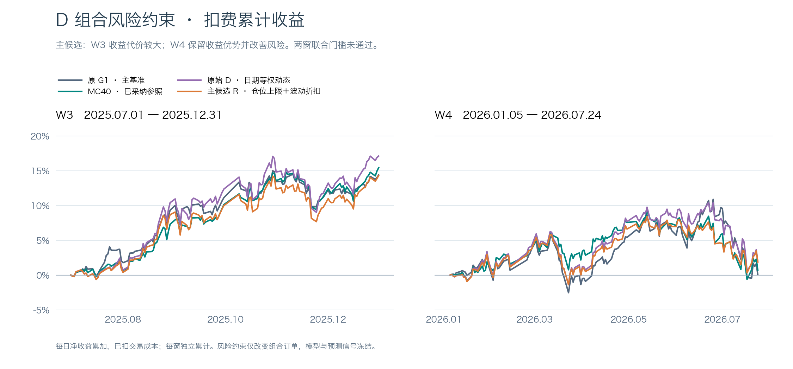
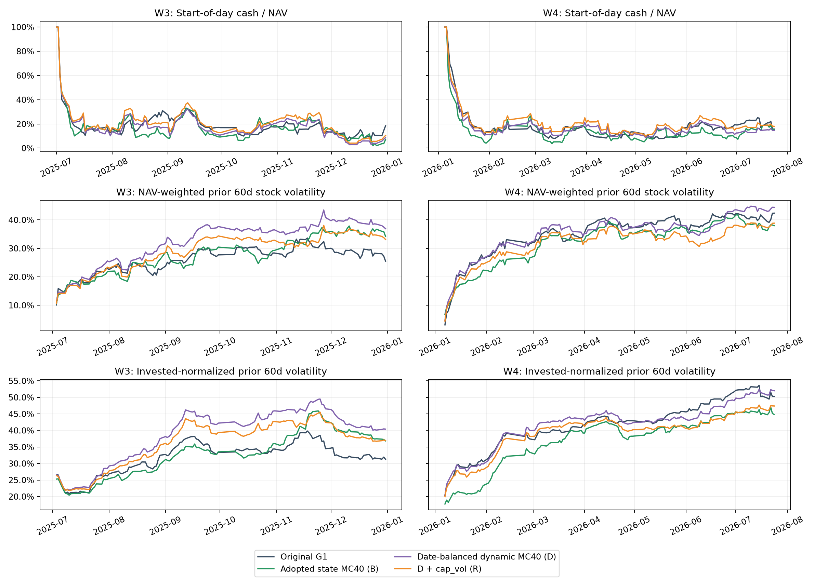
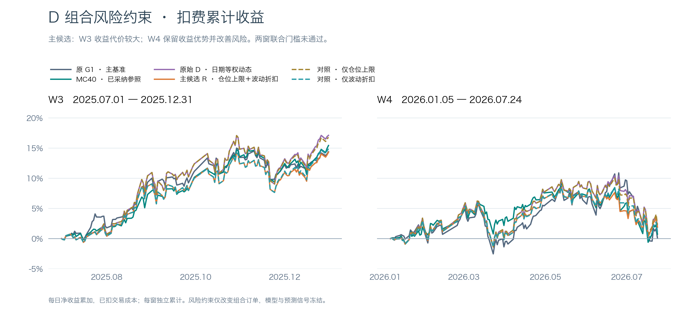
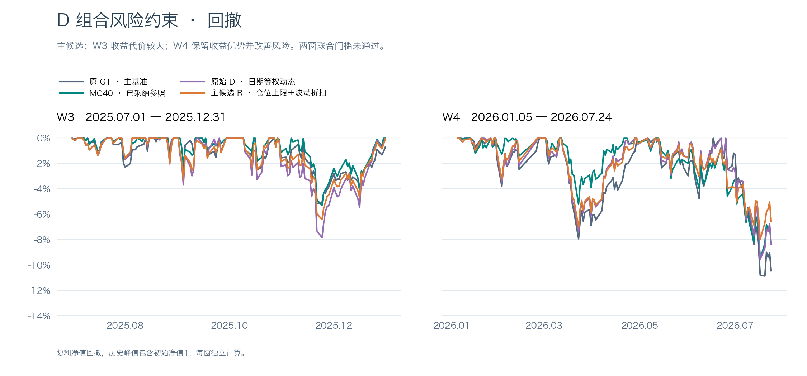
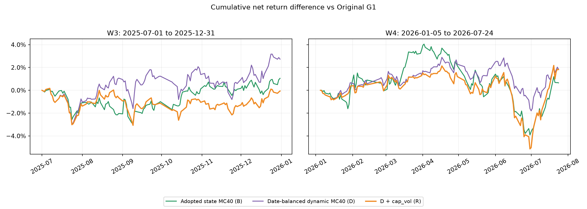

# D组合风险约束实验报告（2026-11-02）

**结论：固定联合门槛未通过。** 主候选cap_vol两窗均保留对原G1和已采纳B的净累计收益优势：否；两窗Sharpe不低于原D且最大回撤不恶化：否。完整两窗回测、真实账户风险归因和曲线已完成；未自动采纳。

本轮仅改变D（日期等权dynamic adapter MC40）的组合订单数量与额外部分减仓层，未训练新模型、未重新生成预测，不代表预测头或状态适配器进步。原G1主基准、B已采纳MC40和源封存产物保持不变。主候选始终为cap_vol，cap_only/vol_only仅为预设诊断对照，不从对照事后择优。



主图为完整日报 `cumsum(return-cost)`，W3/W4共享纵轴；原G1深灰蓝、B绿、原D紫、本轮R橙。主图已由主协调器使用相同日报重绘中文版本，原始英文图保留。

|窗口|方案|净累计%|净复利%|Sharpe|MDD%|年化波动%|总成本%|日均换手%|
|---|---|---:|---:|---:|---:|---:|---:|---:|
|W3|G1_original|14.4018|15.0381|2.3124|-5.1597|12.4564|0.7422|4.8364|
|W3|B|15.4497|16.3250|2.7264|-5.3090|11.3335|0.7601|4.9722|
|W3|D|17.1340|17.9832|2.2288|-7.8357|15.3753|0.6547|4.2972|
|W3|cap_only|16.8100|17.6130|2.2043|-7.8198|15.2520|0.6592|4.3237|
|W3|vol_only|14.9053|15.5486|2.2253|-6.4457|13.3960|0.6597|4.3292|
|W3|cap_vol|14.3357|14.9060|2.1680|-6.4088|13.2250|0.6683|4.3807|
|W4|G1_original|0.0805|-0.6691|0.0090|-10.8645|16.8678|0.4411|2.7591|
|W4|B|0.7321|0.1964|0.0967|-9.5259|14.2382|0.5756|3.5615|
|W4|D|1.9344|1.2535|0.2254|-9.5609|16.1405|0.4561|2.8486|
|W4|cap_only|2.2916|1.6481|0.2734|-9.0086|15.7632|0.4624|2.8855|
|W4|vol_only|1.1294|0.5678|0.1455|-8.4607|14.5967|0.4529|2.8269|
|W4|cap_vol|1.8964|1.3896|0.2552|-7.9784|13.9764|0.4668|2.9075|

W3为2025-07-01至2025-12-31共126日；W4为2026-01-05至2026-07-24共134日。冻结D信号有效格37223/39563。Sharpe用252日、样本标准差ddof1、零无风险利率；MDD以复利净值计算并含初始NAV=1。成本为日成本/NAV之和，换手为原引擎日成交金额/前日NAV（日内买卖双边合计）的日均值。

## 固定门槛和收益优势保留

逐项判定：`{"passed": false, "checks": {"W3": {"above_g1": false, "above_b": false, "sharpe": false, "mdd": true}, "W4": {"above_g1": true, "above_b": true, "sharpe": true, "mdd": true}}, "w3_strict": true}`。任何一窗不满足即不通过，本轮不再调cap、波动窗或折扣强度。

|窗口|相对原D收益损失pp（正值=损失）|R−G1 pp|G1优势保留比例|R−B pp|B优势保留比例|R−D Sharpe|R−D MDD pp|
|---|---:|---:|---:|---:|---:|---:|---:|
|W3|2.7984|-0.0661|-2.42%|-1.1140|-66.14%|-0.0608|1.4270|
|W4|0.0380|1.8158|97.95%|1.1643|96.84%|0.0298|1.5825|

优势保留比例=(R−基准)/(原D−基准)，分母绝对值≤1e-8时记不可解释；负比例表示原优势被反转。MDD差为正表示回撤减轻。

|窗口|参照|R减参照实际差pp|20日非循环移动块95%区间pp|重采样差额>0比例|
|---|---|---:|---|---:|
|W3|G1_original|-0.0661|[-4.8484, +4.7990]|50.66%|
|W3|B|-1.1140|[-5.6962, +3.6244]|31.92%|
|W3|D|-2.7984|[-5.8091, -0.0635]|2.18%|
|W4|G1_original|+1.8158|[-11.7269, +9.3101]|43.34%|
|W4|B|+1.1643|[-6.5085, +6.0674]|52.78%|
|W4|D|-0.0380|[-5.6456, +3.5719]|21.14%|

bootstrap采用配对非循环移动块、末块截断，固定5000次、seed100，仅用于历史诊断；边缘日期的重采样权重不同于中间日期。W3/W4此前反复查看，属于历史开发研究，不是独立盲测；重采样正值比例不是未经选择偏差影响的显著性证明。

## 真实仓位、现金与风险暴露

|窗口|方案|日初最大单股权重均值/峰值%|日末最大权重均值/峰值%|日初HHI均值|日初投资比例均值/峰值%|日初现金均值/峰值%|日末现金均值/峰值%|
|---|---|---|---|---|---|---|
|W3|G1_original|2.47/2.91|2.49/2.91|0.01523|80.85/92.48|19.15/100.00|18.50/100.00|
|W3|B|2.90/3.88|2.92/3.88|0.01561|82.47/98.02|17.53/100.00|16.78/100.00|
|W3|D|3.71/5.41|3.75/5.41|0.01634|81.64/97.14|18.36/100.00|17.63/100.00|
|W3|cap_only|3.47/4.89|3.50/4.89|0.01607|81.49/97.07|18.51/100.00|17.79/100.00|
|W3|vol_only|2.95/4.13|2.98/4.13|0.01493|79.08/96.28|20.92/100.00|20.19/100.00|
|W3|cap_vol|2.77/3.79|2.79/3.79|0.01470|78.80/95.92|21.20/100.00|20.49/100.00|
|W4|G1_original|3.30/5.78|3.32/5.78|0.01605|81.66/92.24|18.34/100.00|17.71/100.00|
|W4|B|4.57/7.25|4.61/7.25|0.01752|85.09/96.29|14.91/100.00|14.28/100.00|
|W4|D|3.49/6.85|3.52/6.85|0.01633|81.97/91.50|18.03/100.00|17.39/100.00|
|W4|cap_only|3.31/5.92|3.34/5.92|0.01593|81.64/91.49|18.36/100.00|17.73/100.00|
|W4|vol_only|3.35/6.31|3.37/6.31|0.01534|79.57/90.29|20.43/100.00|19.81/100.00|
|W4|cap_vol|2.89/4.34|2.91/4.34|0.01472|78.91/90.10|21.09/100.00|20.48/100.00|

W3原D/B日末最大单股权重均值复核为3.75%/2.92%，日末现金均值为17.63%/16.78%。日初口径与日末口径不同，保留两者，不混用。

现金峰值包含初始空仓日，不能忽略这一口径。风险暴露以真实日初权重乘截至前一交易日的历史值，20/60日股票波动均年化；beta为60日沪深300简单beta。

|窗口|方案|20日NAV加权波动%|60日NAV加权波动%|60日持仓内归一波动%|NAV加权beta|60日有效覆盖权重%|
|---|---|---:|---:|---:|---:|---:|
|W3|G1_original|27.48|26.07|31.72|0.771|80.85|
|W3|B|26.63|27.57|32.80|0.728|82.47|
|W3|D|32.60|32.12|38.56|0.941|81.64|
|W3|cap_only|32.41|31.88|38.37|0.932|81.49|
|W3|vol_only|29.75|29.24|36.28|0.832|79.08|
|W3|cap_vol|29.45|28.88|35.99|0.817|78.80|
|W4|G1_original|37.28|35.03|41.89|0.792|81.66|
|W4|B|33.85|32.29|37.13|0.621|85.09|
|W4|D|37.30|35.23|41.96|0.765|81.97|
|W4|cap_only|36.82|34.84|41.67|0.754|81.64|
|W4|vol_only|34.77|32.80|40.21|0.688|79.57|
|W4|cap_vol|33.76|31.91|39.50|0.668|78.91|

W3：R相对D平均日初现金变化+2.84pp，60日NAV加权波动变化-3.24pp，持仓内归一波动变化-2.57pp。现金效应与持股构成变化同时存在，不将低仓位带来的组合波动下降解释成选股或预测能力提高。

W4：R相对D平均日初现金变化+3.06pp，60日NAV加权波动变化-3.32pp，持仓内归一波动变化-2.46pp。现金效应与持股构成变化同时存在，不将低仓位带来的组合波动下降解释成选股或预测能力提高。



行业及流通市值缺可靠PIT接口，本轮不查询、不使用最新值替代。缺风险数据的买入折扣固定0.5；完整缺失审计见risk_features_W3/W4.json及risk_panel parquet。历史价格不向未来填补，风险值使用60个简单收益的ddof1标准差，至少61个收盘价。median_sigma仅在当日有限D信号的CSI300 PIT股票上计算。

## 风险减仓、超限与交易边界

|窗口|风险臂|额外减仓计划/成交笔数|归属风险减仓费用（元）|日末超限天数/股票日|超限原因计数|
|---|---|---|---:|---|---|
|W3|cap_only|2/2|3216.38|92/183|{'not_tradable': 166, 'price_nav_move_or_lot_rounding': 16, 'hold_thresh': 1}|
|W3|vol_only|0/0|0.00|0/0|{}|
|W3|cap_vol|11/11|6463.87|98/327|{'not_tradable': 280, 'price_nav_move_or_lot_rounding': 45, 'hold_thresh': 2}|
|W4|cap_only|8/8|4133.89|91/213|{'not_tradable': 182, 'price_nav_move_or_lot_rounding': 31}|
|W4|vol_only|0/0|0.00|0/0|{}|
|W4|cap_vol|15/15|9452.96|107/356|{'not_tradable': 303, 'price_nav_move_or_lot_rounding': 53}|

vol_only没有目标上限，其超限列为不适用（产物计数为0）。额外减仓成本来自实际成交，合并卖单按额外数量占比归属成本；不是反事实增量成本估计。order_execution_audit.parquet同时保留约束前后数量/估值金额、持有计数、原交易所拒绝及实际成交数量、费用和未成交标记。

not_tradable是继承Qlib交易所的可卖判定，不直接等同现实停牌；逐笔审计另存exchange_suspended/ exchange_limit，原引擎价格限制或缺行情均保持原样，不为风险层放宽。cap_vol实际目标为1.5%至3%（3%×f），不是统一3%硬上限。

上限为过去信息形成的目标，不是每时每刻的硬上限。实际超限逐股逐日列在actual_cap_exceedances.csv：hold_thresh/交易所不可卖/取整为明确阻碍；price_nav_move_or_lot_rounding表示剩余超限可能来自执行日价格与NAV变动或整手余量，不将其武断归因为跳空。原排名换出仍最多5只，额外部分风险减仓是新增交易行为。风险交易改变真实账户路径后，后续原策略入选集合可能改变，最终持仓集合并非逐日固定。

成交保持Top50/drop5/hold5、t信号次日open、买0.001/卖0.0015/最低5、涨跌停0.095、资金1亿、CSI300 PIT、benchmark000300.SH。不增加shift，不使用engine_v2；risk cap=0.03×f，买单先乘f再限额，减仓所得留现金。无针对300308.SZ或其他事后贡献股规则，无行业黑名单。

## 共同回撤、候选自身回撤与个股风险

|窗口|方案|回撤峰日|谷日|恢复日|MDD%|
|---|---|---|---|---|---:|
|W3|D|2025-10-29|2025-11-24|None|-7.8357|
|W3|cap_vol|2025-10-29|2025-11-24|None|-6.4088|
|W4|D|2026-06-22|2026-07-17|None|-9.5609|
|W4|cap_vol|2026-05-13|2026-07-17|None|-7.9784|

W3_candidate_drawdown：R−D逐股净贡献合计1.5065pp。改善前五：`{'601138.SH': 0.35665378563314964, '300308.SZ': 0.22681390132651666, '002463.SZ': 0.2258319512312001, '600183.SH': 0.15324831131563377, '002938.SZ': 0.09610643637651715}`；恶化前五：`{'000776.SZ': -0.025944442291545945, '000157.SZ': -0.023441223546770466, '000338.SZ': -0.018967139720079493, '600886.SH': -0.016400425240820783, '600039.SH': -0.013362617626780279}`。完整逐股及逐日差额已保存。

W3_D_common_drawdown：R−D逐股净贡献合计1.5065pp。改善前五：`{'601138.SH': 0.35665378563314964, '300308.SZ': 0.22681390132651666, '002463.SZ': 0.2258319512312001, '600183.SH': 0.15324831131563377, '002938.SZ': 0.09610643637651715}`；恶化前五：`{'000776.SZ': -0.025944442291545945, '000157.SZ': -0.023441223546770466, '000338.SZ': -0.018967139720079493, '600886.SH': -0.016400425240820783, '600039.SH': -0.013362617626780279}`。完整逐股及逐日差额已保存。

W4_candidate_drawdown：R−D逐股净贡献合计1.0653pp。改善前五：`{'300408.SZ': 0.542995462734657, '605117.SH': 0.13431109174235922, '300014.SZ': 0.10606259588826587, '000792.SZ': 0.09232913025374544, '688126.SH': 0.09168016743158569}`；恶化前五：`{'600176.SH': -0.1784873276632205, '600930.SH': -0.08321278550638399, '300782.SZ': -0.06723617864188164, '300502.SZ': -0.059800632178133195, '003816.SZ': -0.05785676858967087}`。完整逐股及逐日差额已保存。

W3共同区间固定为2025-10-29峰后至2025-11-24谷（不含峰日、含谷日）。候选自身峰谷单独列示，不能仅在原D区间观察后宣称风险消失。每个区间逐股净贡献差与组合日净收益差对账≤1e-10；贡献是实际账户会计分解，不是个股因果效应。

|窗口|方案|300308.SZ净收益贡献pp|该股方差贡献|该股方差份额|
|---|---|---:|---:|---:|
|W3|D|3.9034|0.0000105423|11.24%|
|W3|cap_vol|2.5431|0.0000050835|7.32%|
|W4|D|0.0000|0.0000000000|0.00%|
|W4|cap_vol|0.0000|0.0000000000|0.00%|

W3该股净贡献保留比例65.15%；候选方差贡献前五：`{'601138.SH': 5.931307640781746e-06, '300308.SZ': 5.0835166358370126e-06, '600183.SH': 3.689017213008491e-06, '002463.SZ': 3.1748037966206794e-06, '000408.SZ': 2.961195747750694e-06}`。这些是事后风险复核，不反馈到规则选择。


W4该股净贡献保留比例不可解释（原D该股贡献为零或近零；W4未持有该股）；候选方差贡献前五：`{'600176.SH': 5.158569497830546e-06, '300502.SZ': 4.545747648291286e-06, '300408.SZ': 4.200869202085778e-06, '600522.SH': 3.0856561478417998e-06, '002938.SZ': 2.873172736792055e-06}`。这些是事后风险复核，不反馈到规则选择。

W3候选最大回撤仍为10月29日至11月24日，没有把最大回撤移到别的日期；W4候选峰日提前到5月13日（原D为6月22日），谷日同为7月17日，峰谷跨度从19增至46个交易日，回撤幅度下降伴随更长的峰谷跨度。W3方差贡献首位从300308.SZ变为601138.SH，说明风险主导排序有所变化；W4首位仍为600176.SH。上述是风险分布变化的描述，不证明降低某股权重具有独立因果效应。

方差按Cov(个股净贡献,组合净收益)分解，并保留账户残差项；逐股方差贡献总和与组合样本方差对账≤1e-14。风险是否转移需同时看候选自身峰谷和上述风险主导股，不能由单一股票降权直接推出总体改善。







## 工程门禁、身份与复现

协议SHA256：`784178758cc1b2c9bbc28760f307e4b948279d4bbe2d46500f3c14594c3eafc7`；冻结协议提交：`b24f78b`；base：`7e2cf0324ee2525b592270110c9ab042512cad06`；分支：`codex/d-risk-overlay-20261102`；冻结D权重SHA256：`2c45c8a38559653c9be72facbd8ca911e621f9448f5919573dbfc9a621aaa13d`。本轮GPU新增用时0，未加载模型训练或推理。

最终执行代码提交为03d8ff5（完整SHA见各账户complete.json）；每次执行另记录risk_overlay/run、risk_attribution与原runner的文件SHA，缓存仅在代码及日报SHA匹配时复用。相关规则/既有回归/真实产物交付测试共51项通过，完整测试命令及输出摘要见verification.json；测试不运行训练或查询新行情。

全部12份源输入SHA详见protocol.json；历史特征输入SHA和逐格最后历史日期详见risk_features_W3/W4.json与risk_panel_W3/W4.parquet；代码与小产物身份见delivery_manifest.json。信号直接复用源文件，三风险臂完整身份指向同一D信号，不另造模型身份。

8次原G1/B/D/neutral日报重放最大误差1.017e-15，日期及列完全一致；neutral原始/最终订单与原D逐值一致。所有12臂窗口真实账户贡献、成本、NAV净收益通过对账；实际请求在读取前受market_guard约束，末日≤2026-07-24。

工程修订：首次风险臂尝试发现首日u前日t没有窗口信号，原策略空订单且空仓；增加空决策透传回归测试，不平移信号。协调器独立审查随后指出：退出有效信号池的持仓不等于缺风险，已修正为仅由合法历史sigma决定折扣，信号池只用于median；并将last_history_date与正有限估值价格mask对齐、补齐接口文档。修复均先通过失败回归测试再验证通过。初版六风险回测已经查看，保留在revision01_superseded；修正后重新跑全部8项源/neutral门禁及6项风险回测，结果与初版一致，不从前后版本择优。审查原文见D风险约束独立实现审查_20261102.md。执行计划后补了审查要求，原冻结protocol内完整原文与SHA不变。

运行主机实际标识记录于runtime.json，为WS-EC500T；dev-debian别名在沙箱内无法解析，不能由此确认或否认外部SSH别名映射。使用用户指定工作树、quant环境及DolphinDB后端，保留此环境核验限制。

复现命令（仅CPU，已存在完整标记时复用产物；如需全量重跑请使用独立输出目录并先核验身份）：

```bash
CUDA_VISIBLE_DEVICES='' OMP_NUM_THREADS=4 OPENBLAS_NUM_THREADS=1 /home/user/miniconda3/envs/quant/bin/python -m state_adapter.risk_overlay_run --stage all
/home/user/miniconda3/envs/quant/bin/python -m pytest tests/test_risk_overlay.py tests/test_risk_overlay_delivery.py tests/test_state_factorial.py tests/test_qlib_mean_comparison.py tests/test_date_balanced.py -q
```

原始账户产物在accounts/{W3,W4}/{方案}/：report、positions、trades、balances、stock_daily_contributions、reconciliation_audit、original_orders、风险臂final_orders/order_audit/order_execution_audit。完整数值与图端点由daily及metrics复算。主索引交由协调器处理，本轮不push、不切master、不自动采纳。

累计回测CPU进程用时12.73秒，回测墙钟用时36.75秒，报告生成时总墙钟1360.98秒；另保留归档复跑CPU26.04秒、墙钟74.34秒；GPU新增用时0。开始/截止持久化在execution_clock.json，恢复不重置。


## 主协调器交付核验

基于远端结果提交`03cd705d8d0f14c0f08c3a88e111c67525cdd2a7`，独立重算12组核心指标、14份日报及真实持仓/成交/现金/NAV账、neutral一致性、6组本轮非循环配对块区间，以及全部风险折扣和历史来源日期。均通过。85条实际行情请求记录的有效末日未超过2026-07-24。独立记录为`local_independent_audit_20261102.json`。

独立审查发现的首日无前置信号、退出信号池但风险历史有效的股票处理及历史价格来源日期问题已修正，相关测试和所有固定配置重新执行；初版保存在远端`revision01_superseded`，正式结论仅使用修正实现。主候选未通过联合门槛；仅上限对照仍保留两窗收益优势，但W3夏普从原D的2.2288降至2.2043、回撤仅小幅减轻，也未实现两窗全面改善。没有继续调参或自动采纳。

`delivery_manifest.json`保留远端原始交付的SHA清单；中文图及协调器补充后的本地交付文件以`coordinator_delivery_manifest.json`为准。
