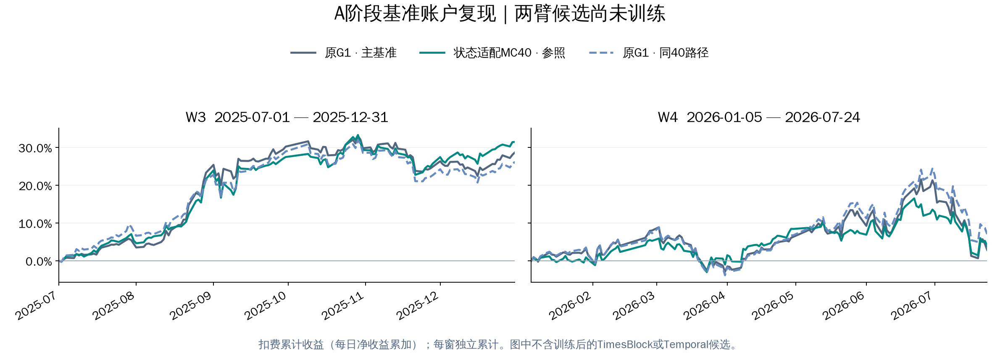

# G1周期残差分支A阶段核验与预算报告

2026-11-17。**A阶段核验记录已完成。原默认12小时GPU预算门禁失败；依据用户已授权的完整两臂实验，root在正式训练前将GPU上限修订为14小时，墙钟仍16小时，保留原累计计时。新A门禁已签署，正式两臂训练已启动；候选W3/W4收益尚未生成，不能判断TimesBlock是否超过原G1或MC40。** 不自动采纳。

改动位于原G1生成头之前的历史残差编码：TimesBlock周期分支与同参数普通一维Temporal分支各99616参数，原G1原权重、tokenizer和粗细token头冻结。原G1为主基准，MC40为竞争参照，纯G1同40路径用于排除采样增量。

## 基准背景图与口径核验

这张图只用于核对已存在基准的执行口径，不是新候选收益图。三个基准×两窗的账户重新计算且独立复算通过。

|窗口|对象|扣费年化|扣费累计和|复利|夏普|最大回撤|成本|日均换手|
|---|---|---:|---:|---:|---:|---:|---:|---:|
|W3|原G1 · 主基准|73.7981%|28.7302%|31.8325%|2.7673|-10.1962%|2.1937%|14.0828%|
|W3|状态适配MC40 · 参照|83.1960%|31.4992%|35.3499%|2.8668|-10.1722%|2.1472%|13.7875%|
|W3|原G1 · 同40路径|65.3328%|26.2452%|28.5818%|2.5127|-10.8966%|2.2710%|14.5730%|
|W4|原G1 · 主基准|1.4886%|2.9072%|0.7888%|0.1930|-19.3894%|2.2193%|13.3949%|
|W4|状态适配MC40 · 参照|5.2186%|4.0769%|2.7419%|0.3360|-14.3241%|2.3810%|14.3605%|
|W4|原G1 · 同40路径|9.8736%|7.0929%|5.1344%|0.4745|-18.0835%|2.1672%|13.0832%|

Temporal与TimesBlock候选：年化、夏普、MDD、累计收益均为**未运行**。

W3完整126日/37223有效股票日期格，W4完整134日/39563格。次日open、Top50/drop5/hold5，买费0.001/卖费0.0015/最低5；pctchange/100与±9.5%简化阈值，保留既有无效open回退限制。

年化=expm1(sum(log1p(net))*252/n)，夏普sqrt252×mean/std(ddof1)，无风险利率0；MDD由含初始净值1的复利净值计算。累计和与复利分列，不混作年化。

## 技术门禁的实际证据

- 官方两个提交及六个源文件SHA固定；19项显式seccomp禁网合成测试通过，并完成独立全分支与局部修复审查。
- 两臂、两窗首中末日期、双随机流共24组零残差信号，与原G1冻结信号逐值一致。原G1与tokenizer原权重身份未变。
- CUDA实际batch64的完整优化器/梯度/CPU CUDA NumPy Python及独立粗头RNG恢复逐值一致；重复floor周期的CUDA回归通过。
- 2048验证窗口均为连续100个市场交易日，目标范围2025-01-02至2025-06-30；历史90日归一化与原生DataFrame路径逐值一致。重建缓存与旧原料逐值一致，未偷偷改写旧缓存身份。
- 原始网格全量通过；冻结原G1与两流数值合成均由root独立逐值核对。六账户逐股损益、现金、净值及日收益已独立复算，42个账户与信号文件SHA已核验。
- 补充真实GPU的32股×20路径满批及10/12股代表性尾批检验通过原定rtol1e-5/atol1e-6；改变其他股票的合成历史时，保护股票的选频完全一致，分支残差与确定性粗细logits均在原阈值内。此处非零up投影仅为工程检查，不是训练候选或选点。
- 必须保留的数值限制：另一次4样本改为逐样本计算，整模型少数近零logits未通过原阈值；原G1自身也未通过，最大绝对差约1.9e-5。该现象与原生batch形状数值差异相容，不能断言所有偏差都来自G1。新增分支残差在原阈值内、频率完全一致。原失败没有回填为通过、没有按观测最大误差放宽阈值，也未改G1算子。正式流程固定canonical股票顺序、32股分块、原始尾批与20路径，不能外推为任意batch大小完全等价。

## 执行修复及保留的失败证据

1. 首次审查发现旧tau协议描述残留和A_accounts重跑覆盖已签证据，两项均在真实A前修复，复用路径保持首次耗时及原证据SHA。
2. 首次真实A遇到cuDNN卷积反向微小非确定性。诊断2/3实际禁用了cuDNN，不能支持当时“只切确定性”的解释；旧记录保留并已纠正。诊断4严格保持enabled=True仅切deterministic，诊断5观察最终源码，均确认两臂及重复周期恢复exact。最终仅在训练更新作用域显式enabled=True、benchmark=False、deterministic=True；不更改模型/目标/学习率/步数/种子。
3. 基准账户跨进程浮点聚合不应要求比特级一致。实际持仓数量/价格、成交数量/价格/金额/费用、逐股pnl/费用完全相同；舍入差约return8.36e-16、NAV7.45e-8元。修复为显式schema：业务原值exact，收益/权重/贡献/换手绝对1e-12、现金/NAV绝对1e-6元，rtol0，未知字段拒绝。真实价格/数量/费用变化仍拒绝；不改引擎、行情、信号或持仓规则。

模型先导证据对应a7d264e，账户最终证据对应737aacd；二者源码差异仅账户比较及测试，不改变模型数学。旧失败日志、旧cache和旧gate均保留，root逐组件核验，未把成本失败回填为通过。

## 成本门禁与待确认资源调整

|项目|保守测算|
|---|---:|
|两臂6000更新|0.6152小时|
|后续固定验证|0.0459小时|
|两臂完整1040日期×流|9.1586小时|
|36个预测诊断截面|0.3181小时|
|后续模型加载|0.0016小时|
|剩余预算估算：上述成本×1.25，再加1800秒余量|13.1742小时|
|A门禁签字前累计模型计算（含失败与诊断）|0.2263小时|
|总GPU预算需求估算|13.4004小时|
|原GPU上限（失败记录保留）|12小时|
|修订后GPU上限|14小时|

这是保守资源估算，不是确定会消耗的时间：不含25%与固定余量的核心剩余计算约10.14小时。A阶段设置余量是为避免两臂训练后剩余预算不足以完成完整回测；不能以削减日期/路径来凑结果。

**正式资源修订：GPU上限12→14小时，墙钟仍16小时。** 12小时是root的默认规划值，并非用户另行指定的上限；本次依据用户对完整实验的既有授权作执行规划修订，不声称用户单独批准了14小时。原first_model_at及已用时间均保留，旧12小时预算失败不回填通过。两臂模型、数据、更新数、选点、路径、窗口和评价规则不变。

已独立复核迁移脚本：固定已审HEAD、暂存区及工作区清洁检查、旧producer源码SHA与实际提交匹配、核心数学函数AST和模型/数据/推理文件不变。原实测元数据逐字归档，新兼容元数据显式标注旧来源及未重算；数组、信号和账本内容不变。仅对新的14/16资源约束重新计算可行性。root签新A_gate后启动两臂完整流水线。该方法避免为预算及账户检查代码的变化重复模型先导，不抹除旧证据。[资源修订](G1周期残差分支资源修订_20261117.md)。

当前执行协议SHA为`c8c0b36e08908ca57fe2cf6672cbd5436002420a8fe5e901bf8477f0e08fc6cf`；旧A协议及其失败记录保持可追溯。本文图是开训前的基准背景图，不是新候选收益图。

## 数据限制与结论边界

本轮实际价格/标签请求逐条核验不晚于2026-07-24，预测输入不晚于各自原点。未来日历元数据不等于未来价格。current-final历史及成员数据是研究假设，available_at/vintage和历史复权版本仍无法验证，不能称完整历史PIT已通过。旧TTA测试曾请求至2026-08-09，实际返回最大日期和旧缓存内容未知；该历史事故不可撤销，不能宣称历史全程封存未读。本轮隔离提供器不使用旧共享行情缓存。

W3/W4已反复查看，仅为开发证据；单训练seed与未来多次尝试限制保留。当前没有新候选经济结果，不能宣称TimesBlock无效、优于G1或超过MC40。

## 复现与证据

远端worktree `/home/user/workspace/Kronos-g1-timesblock`，分支`codex/g1-timesblock-20261117`；协议SHA `4eea6df54dbde2a0910b5b5ea0ba635a966c28efa351f1d3284d8cbbf933c64d`。执行代码不合并到master。

主要证据：A_model.json、A_accounts.json、input_grid.json、root_A_independent_audit.json、root_raw_preflight_restart1.json、root_canonical_batch_probe.json、root_batch_roundoff_diagnostic.json、root_batch_probe_initial_failure.json、budget.json、全部审查报告、diagnose_resume_1..5及其JSON、读取日志和六账户原始parquet。源版本及旧证据归档清单见root_rebuild_authorization.json、root_account_rebuild_authorization.json。

[执行方案](G1周期残差分支执行方案_20261117.md) · [恢复故障诊断](G1周期残差分支恢复故障诊断_20261117.md)。
