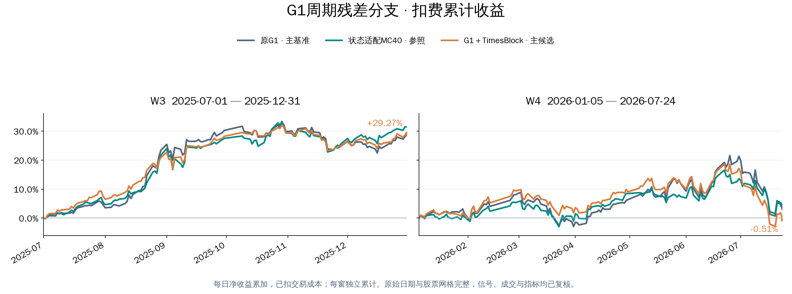
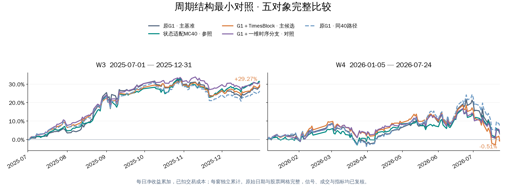
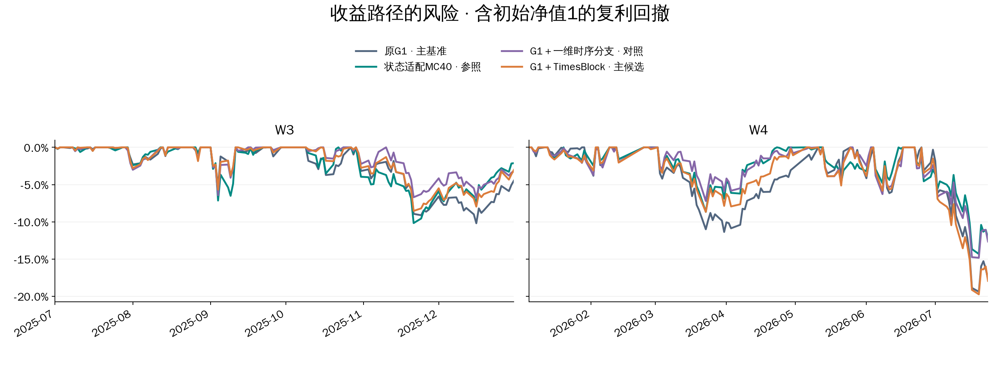

# G1周期残差分支研究报告

实验登记日2026-11-17，完整计算及核验于2026-11-18完成。**主候选TimesBlock未达到目标，不采纳：W3相对原G1三项改善，但年化低于MC40；W4年化、夏普和最大回撤均落后于原G1与MC40。一维时序对照在两窗三项点估计均优于TimesBlock，未见周期折叠的增量优势。** 当前MC40采纳状态不变，控制臂也不自动采纳。

候选从原G1出发，原tokenizer、主干权重及粗细生成头冻结，只在原norm末位增加历史90日驱动的残差向量。新增的是历史编码分支，没有使用MC40适配器、风险头或测试期更新。两臂各99616可训练参数，推理均为seed42/100各20路径。

## 年化、夏普、回撤及完整收益口径

累计收益图为每日净收益累加，每窗独立累计；年化另按复利计算，不能用曲线期末值直接当年化。以下均已扣费用。

|窗口|模型|年化|夏普|最大回撤|净累计和|复利|成本|日均换手|
|---|---|---:|---:|---:|---:|---:|---:|---:|
|W3|原G1（主基准，20路径）|73.7981%|2.7673|-10.1962%|28.7302%|31.8325%|2.1937%|14.0828%|
|W3|状态适配MC40（40路径）|83.1960%|2.8668|-10.1722%|31.4992%|35.3499%|2.1472%|13.7875%|
|W3|G1＋TimesBlock（主候选）|76.5534%|3.2168|-8.5414%|29.2745%|32.8734%|2.1523%|13.8200%|
|W3|G1＋一维时序分支（对照）|81.8971%|3.4114|-6.7733%|30.7519%|34.8692%|2.1737%|13.9560%|
|W3|纯G1同40路径（采样对照）|65.3328%|2.5127|-10.8966%|26.2452%|28.5818%|2.2710%|14.5730%|
|W4|原G1（主基准，20路径）|1.4886%|0.1930|-19.3894%|2.9072%|0.7888%|2.2193%|13.3949%|
|W4|状态适配MC40（40路径）|5.2186%|0.3360|-14.3241%|4.0769%|2.7419%|2.3810%|14.3605%|
|W4|G1＋TimesBlock（主候选）|-4.3072%|-0.0366|-19.7446%|-0.5123%|-2.3140%|2.3160%|13.9716%|
|W4|G1＋一维时序分支（对照）|4.1485%|0.2870|-14.8375%|3.7959%|2.1849%|2.1537%|13.0033%|
|W4|纯G1同40路径（采样对照）|9.8736%|0.4745|-18.0835%|7.0929%|5.1344%|2.1672%|13.0832%|

W3：2025-07-01—2025-12-31，126日/37223有效股票日期格；W4：2026-01-05—2026-07-24，134日/39563格。两臂共1040日期×随机流，完整原始资格网格未裁剪。回测初始资金1亿元、Top50/drop5/hold5、次日open、买费0.001/卖费0.0015/最低5，pctchange/100与±9.5%简化阈值。换手为引擎双边成交额/前日净值的日均值，已用成交记录独立复算。

年化=expm1(sum(log1p(net))*252/n)；夏普=sqrt(252)×mean(net)/std(net,ddof=1)，无风险利率0；MDD以含初始净值1的复利净值计算。

## 最小对照回答了什么

- **相对原G1：** TimesBlock的W3年化提高2.7553个百分点、夏普提高0.4495、回撤幅度减少1.6549个百分点；W4则分别恶化5.7958个百分点、0.2296及0.3552个百分点，没有跨窗同时实现三目标。
- **相对MC40：** W3年化低6.6426个百分点，但夏普更高、回撤更浅；W4年化低9.5259个百分点，夏普更低，回撤幅度增加5.4205个百分点。不能仅用W3风险改善宣称全面超过MC40。
- **周期机制对照：** 一维分支在W3/W4的年化、夏普和回撤六个点估计全部优于TimesBlock。参数数量、数据、3000更新、选点规则、采样路径及交易规则匹配，但有效感受野和部分连接的实际使用不同，不能宣称完全等有效容量或已做完整因果证明。
- **一维分支的线索与限制：** 它对原G1两窗三项点估计都改善；然而W4年化/夏普低于纯G1同40路径，也未全面超过MC40。因此收益不能全部归因于新增模型结构，不能将控制臂事后改名为预先选定赢家或自动采纳。

## 收益与风险差异的来源

以下是冻结账户的后验会计分解，不是个股或模型机制的干预因果证据。差额单位为每日净收益累计和的百分点，不是年化差。

|窗口|TimesBlock−MC40毛收益差|费用节省|净累计差|TimesBlock年化波动|MC40年化波动|
|---|---:|---:|---:|---:|---:|
|W3|-2.2197|-0.0050|-2.2247|18.2012%|21.9751%|
|W4|-4.6542|0.0650|-4.5892|26.3018%|22.8155%|

W3相对MC40的日均净收益略低，但波动下降更明显，因此夏普提高；这是收益与风险的取舍。W4则日均净收益转负、波动高于MC40，费用虽节省约0.0650个百分点，仍无法弥补约4.6542个百分点的毛收益落差。主要差距不来自费用。

在TimesBlock的W4最大回撤共同区间（2026-06-22收盘峰值至07-20低点），TimesBlock复利损失19.7446%，MC40为14.3241%，一维对照为14.8375%；原G1同区间为17.4983%（不同于其全窗最大回撤）。这确认了后段风险差异，而非将不同模型不同峰值区间混作同一段。

相对MC40的逐股净贡献差已对账。W4主要负贡献差包括601872.SH、300661.SZ、601100.SH、300308.SZ、600549.SH；这些是“相对贡献差”，不等于每只股票都发生绝对亏损。绝对贡献差Top5占比约12.61%，不能用单一股票解释全部差距。完整日期、个股及费用分解保存在root_economic_interpretation.json。未使用当前行业或市值替代历史PIT暴露。

## 预测与结构诊断

两臂均完成3000更新、192000次窗口抽样，3000个批次原始数据与日期SHA逐步相同。按固定2048个2025H1验证窗口及seed103100，含步0、每500步评估、最早最低CE选点，两臂均选第3000步。

|对象|未来token验证CE|预登记末端预测RankIC|补充：均价信号对末端收益RankIC|与G1即时信号Top50重合|
|---|---:|---:|---:|---:|
|原G1|3.03525557|0.079763|0.052692|100.00%|
|一维对照|3.03155160|0.073653|0.048413|80.83%|
|TimesBlock|3.03280806|0.078388|0.050861|84.17%|

RankIC来自固定12个H1日期、共同3529个有效标签样本；12日均可计算。预登记指标是预测第10日末端收益对实际第10日收益的RankIC；交易实际使用未来10日预测收盘均值信号，故补充分列该信号对同一末端目标的RankIC，没有替换原指标或用其重新选点。Top50重合是即时信号集合，不是受持仓约束后的实际持仓重合。

两个新分支的token CE略降，但这12日的两种RankIC都没有超过原G1。CE改善不能直接视为选股排序改善。H1已参与检查点选择，以上属于开发期回看诊断，不是这些历史时点当时可得模型的独立前瞻验证，也不用于证明泛化。

TimesBlock的2048验证窗口中，1712个（83.59%）首选90交易日折叠，275个首选45日；融合权重平均96.23%集中在第一候选，第一候选权重中位数99.9958%。按权重计算，90日与45日折叠合计约96.67%。90日历史折成90日尺度只有1行，45日尺度只有2行；这不是发现了稳定的90日或45日可交易周期。频谱来自可学习嵌入加固定位置编码，可能混有趋势、位置编码和短窗效应，未单独分离其贡献。

这些结构观察与“本轮未显示周期增量”一致，但不能据此把W4退步完全归因于某一个模块，也不能外推为所有TimesNet实现均无效。这里只检验了冻结G1、历史残差注入、宽度32、top2、单TimesBlock这一固定改造。官方整模型的连续预测、未来潜表示扩展与本轮不同。

## 配对区间与结论边界

固定同日期20日循环块、5000次、seed100，收益/年化/夏普/MDD逐项重算；8组×4指标由独立实现复算，区间最大绝对差约1.75e-15。相对原G1与MC40的主要差值区间均跨零，不能说已证明稳定正向增益；不显著也不等于证明等价。相对同40路径G1，W3夏普和MDD差区间为正，但收益区间仍跨零，且W4没有重复该优势。

|窗口|参照|净累计差（百分点）|95%区间（百分点）|
|---|---|---:|---|
|W3|原G1（主基准，20路径）|0.5444|[-13.7658, 11.0357]|
|W3|状态适配MC40（40路径）|-2.2247|[-11.6348, 7.3322]|
|W3|G1＋一维时序分支（对照）|-1.4774|[-6.3297, 3.7916]|
|W3|纯G1同40路径（采样对照）|3.0293|[-2.1952, 8.0549]|
|W4|原G1（主基准，20路径）|-3.4195|[-16.1673, 7.8756]|
|W4|状态适配MC40（40路径）|-4.5892|[-19.1617, 8.1427]|
|W4|G1＋一维时序分支（对照）|-4.3082|[-16.9872, 7.2135]|
|W4|纯G1同40路径（采样对照）|-7.6052|[-23.6902, 6.9875]|

单训练seed和两条固定推理随机流、反复查看W3/W4及多次历史尝试的选择偏差仍存在；这些区间以当前冻结权重与信号为条件，没有消除这些限制。全部逐指标区间保存在economic_result.json及root_independent_audit.json。

## 防泄漏、批次依赖及工程修订

- 新分支仅编码发行原点前90日，未来10步固定；逐样本选频，无跨batch统计，stock-first扩展20路径。token输入固定发行历史并仅追加此前目标日prefix末token，监督不使用该目标之后信息。原G1粗细生成接口保留。
- 19项工程回归加2项资源边界测试通过；24组零残差真实信号逐值复现原G1。当前设备的canonical满批和代表性尾批非零残差测试在原阈值内，选频exact。4→1样本的整模型少数近零logits未达原阈值，原G1自身也有同类数值差异；原失败保留，不宣称任意batch大小完全等价，不调整G1算子追通过。正式股票顺序、32股分块及尾批均固定。
- 训练更新显式开启cuDNN并使用确定性卷积，真实CUDA两臂及重复周期恢复逐值通过。先前诊断2/3实际关闭cuDNN的错误解释已纠正，失败及更正证据均保留；没有用放宽训练exact标准掩盖问题。
- 六个冻结参照账户在候选完成后再以新进程重放，确认与本轮缓存基准的交易/账本口径一致；10个账户从实际持仓、成交、现金独立复算，1040个流、原始资格格、精确数值合流、指标及图端点均通过。派生汇总允许声明的浮点舍入，原始交易与价格仍exact，不称所有账本浮点比特都相同。
- 本轮价格/标签请求与返回边界检查未越过2026-07-24，预测输入不晚于原点；未来日历不是未来价格。current-final历史/成员及复权版本是假设，available_at/vintage未证实，不称完整真实历史PIT。日频涨跌幅限制与无效open回退仍是固定模拟简化，模型读取因果检查不等于盘中可执行性证明。
- 旧TTA测试曾请求至2026-08-09，实际返回最大日期及旧共享缓存内容未知；该事故不可撤销。本轮独立隔离读取不使用旧共享行情缓存，不能宣称整个历史聊天从未读过封存数据。

## 资源与可复现证据

累计模型计算区间10.0796小时，至独立尾处理完成的墙钟11.7499小时，均在最终14/16小时上限内。原first_model_at未重置。默认12小时GPU成本门禁未过，开训前root依据已授权完整实验修订到14小时，墙钟仍16；不是用户另行明确指定14小时，也不是看收益后追加搜索。旧12小时失败和全部旧元数据逐字保留，新兼容证据有原producer来源及SHA，核心数学/数据未改。

- 分支：`codex/g1-timesblock-20261117`；科学实现`737aacd`，资源修订`1f5b391`，后续文档提交不改变模型源码。
- 执行协议SHA：`c8c0b36e08908ca57fe2cf6672cbd5436002420a8fe5e901bf8477f0e08fc6cf`。
- Temporal最佳权重SHA：`053abf29755d01e96fdacd5117719dc2edc41ca9a628343d711b05d663ea90d8`。
- TimesBlock最佳权重SHA：`dc63328eb3b27e105f5c907a1bd4d3fa1f85e8cf1b0eccbd38af67139652189e`。
- 核心独立证据：root_training_audit.json、root_independent_audit.json、root_final_quote_parity.json、root_signal_ci_audit.json、root_diagnostic_audit.json、root_economic_interpretation.json、root_figure_audit.json。原始日报/持仓/成交/余额/逐股贡献、逐日信号、协议/权重身份、读取日志与预算均留存于本轮OUT。
- 原自动生成报告保存在report_generated.md；本报告是核验后的解释版，单独维护摘要，不覆盖原报告来源。

[方案](G1周期残差分支执行方案_20261117.md) · [资源修订](G1周期残差分支资源修订_20261117.md) · [CUDA故障与纠正](G1周期残差分支恢复故障诊断_20261117.md) · [账户浮点比较](G1周期残差分支账户舍入比较修正_20261117.md)。

[论文](https://arxiv.org/pdf/2210.02186) · [官方仓库](https://github.com/thuml/TimesNet)。官方源码已固定TimesNet提交2b39e14与其指向的Time-Series-Library提交4e938a1，许可证与SHA保留。这是基于TimesBlock的改造，不是整套论文复现。
