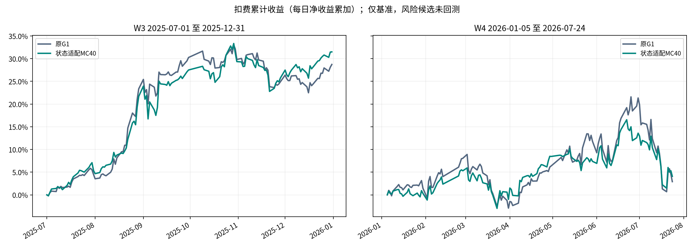
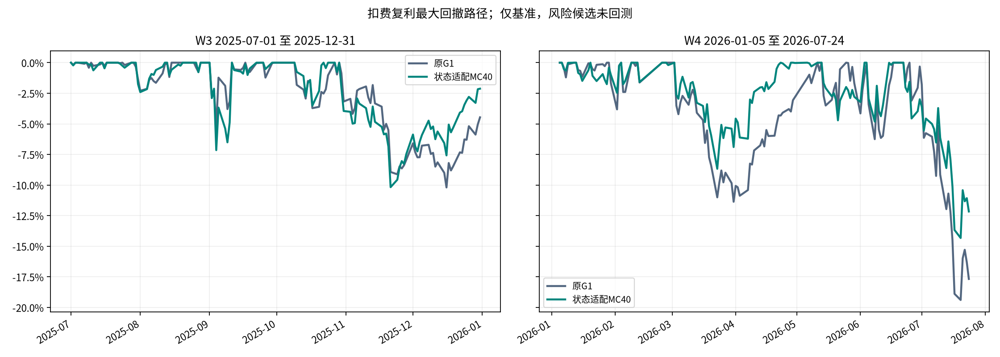
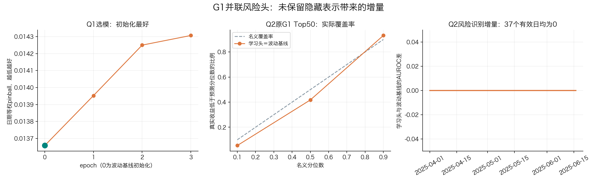

# G1并联下行风险头研究报告

本轮训练与机制检验已完成并独立复算，但未通过预登记门槛：Q1选择初始化epoch 0，最终头等同历史波动基线，Q2风险识别增量为0。依已批准计划停止，风险候选经济回测未运行；没有新候选的年化、夏普或回撤成绩，不能据此判断它是否跑赢MC40。

原G1收益信号保留；冻结其表示上学习分位数风险，使用固定0.25风险排名扣分。MC40是竞争参照，没有参与新头训练。



|窗口|方案|扣费年化|净累计|复利|夏普|最大回撤|成本|日均换手|
|---|---|---:|---:|---:|---:|---:|---:|---:|
|W3|原G1|73.7981%|28.7302%|31.8325%|2.7673|-10.1962%|2.1937%|14.0828%|
|W3|状态适配MC40|83.1960%|31.4992%|35.3499%|2.8668|-10.1722%|2.1472%|13.7875%|
|W4|原G1|1.4886%|2.9072%|0.7888%|0.1930|-19.3894%|2.2193%|13.3949%|
|W4|状态适配MC40|5.2186%|4.0769%|2.7419%|0.3360|-14.3241%|2.3810%|14.3605%|

年化按252交易日复利折算，夏普ddof=1，MDD包含初始净值1；W3/W4独立账户、不拼接成未验证实盘。原固定Top50/drop5/hold5、费用、pctchange/100简化9.5%和次日执行保留，原引擎无效open回退close的限制保留。



## 机制与限制



|epoch|Q1真实收益尺度pinball（越低越好）|
|---|---:|
|0|0.013658371|
|1|0.013952623|
|2|0.014250145|
|3|0.014306886|

训练epoch 1至3的归一化训练损失下降，但Q1验证损失连续高于初始化。按原patience=3和最早最优规则选择epoch 0；没有按Q2或W3/W4挑权重。该结果只否定本轮固定线性风险读出的增量，不证明所有风险预测头无效。

新风险头与波动风险策略的W3/W4经济指标均标为“未运行”；上方累计图和表格仅是已核验参照，不是新候选曲线。

Q1选定epoch 0；Q2 q10 pinball：学习 0.00976368，波动基线 0.00976368；原G1 Top50有效日期风险AUROC增量 0.0。

q10是单股收益下分位，不是ES或组合MDD。标签是次日open到第十日close的毛收益，不等同动态换仓策略的逐笔净收益。单股校准改善不自动证明组合价值；历史波动基线采用相同尺度。

当前库历史最终值为研究假设，available_at和历史复权vintage不能证明；2025H1及W3/W4反复查看，仅开发证据。上一轮TTA旧测试曾请求至2026-08-09、实际返回范围未知，本轮不撤销该事故、不声称历史全程未读。新读取从独立有界入口开始，审计和旧事故分别披露。

分位数全体/原G1 Top50/历史波动分组逐日校准、20日循环块区间见mechanism_gate.json及Q2_calibration_*.csv。经济指标差的区间逐指标重算，收益区间不套用于夏普或MDD。

完整机器结果：
```json
{
  "mechanism_passed": false,
  "economic_complete": false,
  "metrics": {
    "W3": {
      "G1_original": {
        "annualized": 0.7379811157295478,
        "net_sum": 0.28730165661562196,
        "compound": 0.3183251176130819,
        "sharpe": 2.76728013870072,
        "mdd": -0.10196249734285412,
        "cost": 0.021937117778495205,
        "turnover": 0.14082834143068523
      },
      "MC40": {
        "annualized": 0.8319597793630705,
        "net_sum": 0.314992237064521,
        "compound": 0.3534990873151971,
        "sharpe": 2.866813541973098,
        "mdd": -0.10172170258322455,
        "cost": 0.021472280810922027,
        "turnover": 0.13787508326554684
      }
    },
    "W4": {
      "G1_original": {
        "annualized": 0.014885992188678804,
        "net_sum": 0.029071596012616045,
        "compound": 0.007888179001410922,
        "sharpe": 0.19298050189994595,
        "mdd": -0.1938936911628799,
        "cost": 0.022192982842427635,
        "turnover": 0.13394940657044654
      },
      "MC40": {
        "annualized": 0.05218621581639809,
        "net_sum": 0.04076916184667749,
        "compound": 0.02741915092870917,
        "sharpe": 0.3360452792092778,
        "mdd": -0.1432410195897298,
        "cost": 0.023810078542136653,
        "turnover": 0.14360494481860425
      }
    }
  },
  "economic_gate": {
    "all_passed": false,
    "reason": "Q2机制门禁未通过，未执行C",
    "auto_adopt": false
  },
  "comparisons": {},
  "protocol_sha": "e8f0c9ef6b418960cf7354a64a8055b2714e7a82887ca55a0a821deacde0adaf",
  "head_sha": "50b068883d69cf299c01a1cb7b89e4849b833d103d7c96f7284b79d20670273d",
  "bootstrap": {
    "block": 20,
    "resamples": 5000,
    "seed": 100
  }
}
```

复现入口：g1_risk_head.run、g1_risk_head.accounts、g1_risk_head.report。研究分支codex/g1-risk-head-20261105；完整协议、读取审计、日事务与冻结身份保存在artifacts/experiments/g1_risk_head_20261105。未合并实验代码。

## 执行、独立复算与原始证据

- A通过：既有33项安全测试、新增21项禁网回归；真实原G1输入归一化、norm后隐藏表示和重复前向逐值一致；两窗lambda0账户复现，日报最大误差分别9.97e-16和8.86e-16，持仓/成交/余额按业务键通过。完整输入格为126日37223格与134日39563格。
- 用户明确追加授权仅补2025Q2原G1信号，seed42、20路径、32股分块；W3/W4原G1及MC40信号未重生成或替换。Q2 60个原点完整落盘，50个原点的完整标签留在Q2内，末10日起点未读取跨段标签。
- 训练534日、143058个监督样本；Q1 47日13812样本；Q2 60日17639预测格、14692有效监督样本。Top50校准覆盖50日2500样本，AUROC仅37日有正负两类，其他日期不伪造AUROC。
- 最终选中头为2499参数，linear.weight逐值为零，bias逐值等于训练Z的经验分位数，故输出与波动基线完全一致。Q2总体q10损失均为0.009763680879；Top50平均AUROC差0。Top50 q10实测覆盖率5.4%，20日循环块95%区间[2.28%,8.40%]，不能把模型输出当成已校准的真实10%风险保证。
- 协调器独立脚本逐日复核事务SHA、预测输入日期、原始标签价格、Y和历史尺度、checkpoint身份、选点、Top50/AUROC、分组校准区间、参照经济指标及图端点，全部通过。由于未进入C，本轮不存在学习头逐股账户、经济配对区间或收益增量，不能以空表冒充通过。
- GPU预算保守累计3131.56秒（52.19分钟），包含16:25硬退出后未结算区间至16:45恢复的保守计费；这不等于实际GPU满载时长。首次真实模型计算16:05:05，报告17:02:25生成，均为2026-11-05 Asia/Shanghai，约57分20秒墙钟。原6小时GPU/10小时墙钟预算未重置。

执行裁决与代价：使用已修复隔离入口的047ac95为代码基线，避免把旧入口带回；若依赖失配会损害保真，已通过真实模型/账户对拍。按用户封存约束只跑显式禁网测试，未运行全仓pytest，因此不声称全仓测试通过。预处理修正为实际原G1的float32先转换再归一化；若遗漏会改变token，本次经失败回归及原生逐值对拍验证。正惩罚新并列用唯一序数显式按分数/代码排序，lambda0保留原分数与原并列行为。独立审查的5项Important均修复，Minor授权状态文档已更新，无未处置审查问题。

本轮新读取边界检查全部通过，最大真实读取日2026-07-24；这不撤销上轮越界查询事实，也不证明current-final数据具有真实历史vintage。条件下分位数同时反映位置与离散程度，不能把未来可能的收益改善全部归因于纯波动预测。

[独立复算结果](../artifacts/experiments/g1_risk_head_20261105/independent_final_audit.json) · [复算脚本](../artifacts/experiments/g1_risk_head_20261105/verify_result.py) · [机制结果与分组区间](../artifacts/experiments/g1_risk_head_20261105/mechanism_gate.json) · [Q2原G1信号](../artifacts/experiments/g1_risk_head_20261105/Q2_G1_supplement.parquet) · [A门禁](../artifacts/experiments/g1_risk_head_20261105/A_gate.json) · [特征校验清单](../artifacts/experiments/g1_risk_head_20261105/feature_identity_manifest.json)。

完整特征缓存约1GB，保留在dev-debian本轮OUT/features；本机已回收报告、图、Q2信号、逐日诊断、头权重、源码快照与小证据。独立复算脚本从远端原始特征执行，不能在仅含小证据的本机目录直接当作已复制全量特征运行。

补充恢复验证：在独立验证目录使用实际训练函数，于epoch1原子checkpoint后中断并恢复至epoch3，参数、optimizer、RNG、history、best和早停计数均与原运行逐值一致；未改变原研究权重或选点。[恢复证据](../artifacts/experiments/g1_risk_head_20261105/training_resume_audit.json)。研究管线用时57分20秒，包含最后独立复核至预算核验时共79分18秒，仍在原10小时墙钟上限内；GPU保守计费52.19分钟。[预算核验](../artifacts/experiments/g1_risk_head_20261105/delivery_budget_audit.json)。
