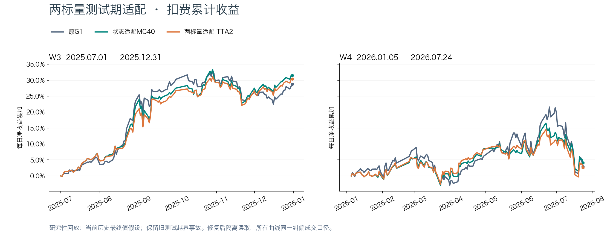
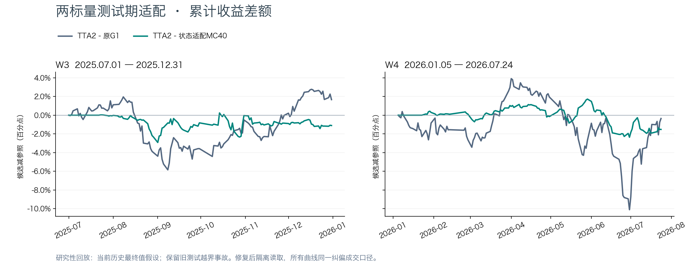
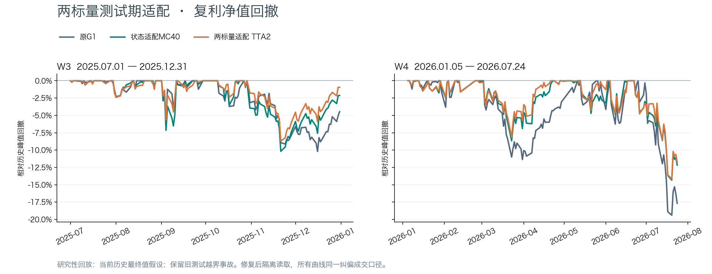
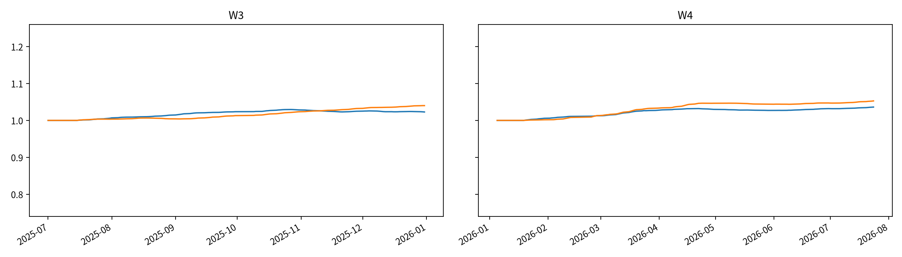

# MC40两标量研究性回放报告

两标量适配未形成跨窗收益提升：W3扣费累计30.3974%，高于原G1但低于MC40；W4为2.5568%，低于两者。W3夏普与回撤改善，W4相对MC40夏普下降、回撤仅略改善，不替换已采纳MC40。此次仅为当前历史最终值假设下的研究性回放；旧测试越界事故永久保留，整体封存非访问要求未通过。

原G1为主基准，状态适配MC40为参照；候选只增加最后两层残差的两个共享标量，所有原权重冻结。



|窗口|模型|净累计|复利|夏普|最大回撤|成本|日均换手|
|---|---|---:|---:|---:|---:|---:|---:|
|W3|MC40-TTA2|30.3974%|34.1963%|3.0997|-8.6982%|2.1750%|13.9640%|
|W3|原G1|28.7302%|31.8325%|2.7673|-10.1962%|2.1937%|14.0828%|
|W3|状态适配MC40|31.4992%|35.3499%|2.8668|-10.1722%|2.1472%|13.7875%|
|W4|MC40-TTA2|2.5568%|1.2339%|0.2142|-14.1404%|2.3664%|14.2732%|
|W4|原G1|2.9072%|0.7888%|0.1930|-19.3894%|2.2193%|13.3949%|
|W4|状态适配MC40|4.0769%|2.7419%|0.3360|-14.3241%|2.3810%|14.3605%|

W3 126日37223有限格；W4 134日39563有限格。Top50/drop5/hold5、次日open、买费0.001/卖费0.0015/最低5，涨跌停为pctchange/100±0.095。夏普std使用ddof=1；MDD含初始净值1。

## 收益差额与风险

相对原G1，W3净累计提高1.6673个百分点，W4降低0.3504个百分点；相对MC40，两窗分别降低1.1018和1.5201个百分点。四组20日循环块配对收益差95%区间均跨零，不能宣称显著提升。

W3相对MC40夏普从2.8668升至3.0997，最大回撤从−10.1722%减轻至−8.6982%；W4夏普从0.3360降至0.2142，回撤从−14.3241%微幅减轻至−14.1404%。这是部分风险指标改善，不能等同收益和预测能力全面改善。







可用性假设：当前库历史最终值，event_date顺序回放，假设18:00可用、18:15发行。无法验证历史修订、真实延迟、历史复权版本与成员发布时间，绝不称真实历史版本PIT通过。旧A审计证据保留。

预测token CE在标签成熟时，用发行当日保存的a回算（独立诊断seed100）；另列成熟时当前状态的更新前CE。两者在发行时均未知。RankIC对应已发行信号与可得完整10日收盘目标，延迟11交易日，末11起点不在本窗消费；覆盖和跳过数见下。单更新seed100，两推理流42/100；多次查看历史带来的选择偏差不由bootstrap消除。

配对区间固定20日循环块、5000次、seed100；所有指标与计数：
```json
{
  "W3": {
    "metrics": {
      "MC40-TTA2": {
        "net_sum": 0.3039741822935658,
        "compound": 0.3419634053518108,
        "sharpe": 3.099743797878651,
        "mdd": -0.08698160735955085,
        "cost": 0.021749833849219097,
        "turnover": 0.13963950681602585
      },
      "原G1": {
        "net_sum": 0.28730165661562196,
        "compound": 0.3183251176130819,
        "sharpe": 2.76728013870072,
        "mdd": -0.10196249734285412,
        "cost": 0.021937117778495205,
        "turnover": 0.14082834143068523
      },
      "状态适配MC40": {
        "net_sum": 0.314992237064521,
        "compound": 0.3534990873151971,
        "sharpe": 2.8668135419730976,
        "mdd": -0.10172170258322455,
        "cost": 0.021472280810922027,
        "turnover": 0.13787508326554684
      }
    },
    "comparisons": {
      "原G1": {
        "observed_sum": 0.016672525677943986,
        "observed_mean_daily": 0.0001323216323646348,
        "lower_95": -0.12024014827550618,
        "upper_95": 0.1353053922991831,
        "block_length": 20,
        "resamples": 5000
      },
      "状态适配MC40": {
        "observed_sum": -0.011018054770955212,
        "observed_mean_daily": -8.744487913456518e-05,
        "lower_95": -0.0501825368260977,
        "upper_95": 0.028526292726156643,
        "block_length": 20,
        "resamples": 5000
      }
    },
    "diagnostics": {
      "mature_samples": 33915,
      "skipped": 69,
      "updates": 115,
      "issued_token_ce": 2.604800210167099,
      "mature_preupdate_token_ce": 2.6044821988828026,
      "mature_rankic": 0.013835313280323362,
      "rankic_samples": 33915,
      "rankic_dates": 115,
      "max_read": "2025-12-31"
    }
  },
  "W4": {
    "metrics": {
      "MC40-TTA2": {
        "net_sum": 0.02556773209398212,
        "compound": 0.012339185524553375,
        "sharpe": 0.21416931996882058,
        "mdd": -0.14140407174189595,
        "cost": 0.023664356769603885,
        "turnover": 0.14273212185640174
      },
      "原G1": {
        "net_sum": 0.029071596012616045,
        "compound": 0.007888179001410922,
        "sharpe": 0.19298050189994592,
        "mdd": -0.1938936911628799,
        "cost": 0.022192982842427635,
        "turnover": 0.13394940657044654
      },
      "状态适配MC40": {
        "net_sum": 0.04076916184667749,
        "compound": 0.02741915092870917,
        "sharpe": 0.33604527920927785,
        "mdd": -0.1432410195897298,
        "cost": 0.023810078542136653,
        "turnover": 0.14360494481860425
      }
    },
    "comparisons": {
      "原G1": {
        "observed_sum": -0.0035038639186339184,
        "observed_mean_daily": -2.6148238198760586e-05,
        "lower_95": -0.1795181864398306,
        "upper_95": 0.18042695012152035,
        "block_length": 20,
        "resamples": 5000
      },
      "状态适配MC40": {
        "observed_sum": -0.015201429752695401,
        "observed_mean_daily": -0.00011344350561712986,
        "lower_95": -0.07887549669347464,
        "upper_95": 0.03612593264151871,
        "block_length": 20,
        "resamples": 5000
      }
    },
    "diagnostics": {
      "mature_samples": 36253,
      "skipped": 39,
      "updates": 123,
      "issued_token_ce": 2.6533923888046673,
      "mature_preupdate_token_ce": 2.6528477137116333,
      "mature_rankic": 0.04066059828622406,
      "rankic_samples": 36253,
      "rankic_dates": 123,
      "max_read": "2026-07-24"
    }
  }
}
```

复算入口：`python -m state_adapter.tta_report`。协议、冻结源SHA、execution_versions、日事务与预算位于本轮OUT。正式回放命令：`python -m state_adapter.tta_run replay`，需要root review_gate.json。

## 必须保留的封存查询事故

执行者扩大旧回归测试时误运行真实DDB集成测试，请求截至2026-08-09，违反2026-07-24封存要求。正式TTA worker与测试进程独立不撤销该违规；不能声称全程封存未读。完整事故记录与原日志保留。
[事故记录](../artifacts/experiments/mc40_tta_research_20261104/sealed_query_incident.json)


旧测试请求截至2026-08-09；实际返回最大日期、历史共享缓存内容未被捕获，仍然未知，没有再次读取封存数据补证。保留日志仅呈现测试通过状态，未打印价格和日期明细；该状态仍包含整个请求区间的一致性断言信息。不能将模型哈希不变解释为历史事故没有发生。

原G1、tokenizer、MC40适配器及研究协议与事故前冻结SHA一致；测试源码没有把返回数组传入正式学习进程，也未保存覆盖原模型，未发现根据事故输出更改参数的记录。后续隔离保证与旧测试实际返回范围未知必须分开理解。

修复后学习走逐时点有界原始SQL；评价使用全新进程、独立会话、禁用共享缓存与有界SQL。root独立审核了33项禁网回归，旧pilot/grid按精确SHA显式迁移，学习代码未改；T00018.SH兼容修复047ac95不改变研究配置。新隔离评价器与冻结原G1/MC40四账户按日期、证券等业务键核对通过，日报最大误差2.25e-15，持仓、成交和余额一致。

固定交易规则仍有研究简化：统一9.5%阈值不是所有板块真实涨跌停；配置次日open，原引擎无效open回退close行为保留。真实可交易性、历史发布时点和历史复权版本未经证明。

审计入口：[隔离修复与接续](MC40隔离核验与回放接续_20261104.md)、[事故记录](MC40测试期适配封存查询事故记录_20261104.md)、[隔离原始证据](../artifacts/experiments/mc40_tta_research_20261104/isolation_audit.json)、[四参照账户核验](../artifacts/experiments/mc40_tta_research_20261104/root_reference_parity.json)。

## 独立复算与预测排序对照

本机离线复算通过：六组净累计、复利、夏普、最大回撤、成本和换手；四组配对收益差区间；两候选账户从逐股持仓、成交价、数量和费用重建毛净收益、现金及净值；260个日事务文件SHA与前序链、原始股票日期有限格、两随机流精确合流、主图端点均通过。

逐日验证首11日两标量为1，随后每次仅消费第t−11日起点的10日完整标签，标签末日为t−1，两窗独立冷启动。W3更新115次、有效33915个股票样本，跳过69；W4更新123次、有效36253个样本，跳过39；末11个起点不消费反馈。快照90日输入日期不晚于发行日，标量均在预设范围内。正式worker与隔离评价的落盘读取记录无新越界；此结论不覆盖旧测试事故。

在候选实际使用的同一成熟标签与股票集合上重算日均Spearman RankIC，未新增行情查询或模型计算：

|窗口|原G1|状态适配MC40|两标量TTA2|TTA2−MC40|
|---|---:|---:|---:|---:|
|W3|0.011508|0.012945|0.013835|+0.000890|
|W4|0.042509|0.042553|0.040661|-0.001893|

W3排序相关性略升，W4下降，没有一致预测增益；这里是描述性日均RankIC，未宣称统计显著。token CE仅有本候选发行时/更新前诊断，没有同种子冻结MC40的完整配对CE，不据此宣称token预测能力胜出。

正式源码为047ac95，分支codex/mc40-tta-20261104；协议SHA为6f4ebabb0dcd46e46ba5e0779c52fb9f896f6d21f5b4141112aac461f1a87016，原MC40适配器SHA为d208a8b9f5359aa81bd6cfff473bf9aae193f0b37542e92b7ae39d00c649c402。研究配置未按W3/W4改动，不自动采纳。

独立复算入口：[脚本](../artifacts/experiments/mc40_tta_research_20261104/verification/local_delivery_recheck.py)、[复算结果](../artifacts/experiments/mc40_tta_research_20261104/verification/local_final_audit.json)、[同样本RankIC](../artifacts/experiments/mc40_tta_research_20261104/verification/paired_rankic.csv)、[每日标量与成熟样本](../artifacts/experiments/mc40_tta_research_20261104/verification/daily_updates.csv)、[图表端点](../artifacts/experiments/mc40_tta_research_20261104/verification/figure_endpoints.json)。完整原始日事务已回收到本机同名replay目录，体积约579MB，未纳入Git；Git保留复算入口与小证据。

候选逐股重建日报最大绝对误差：W3 6.45e-16，W4 6.89e-16。GPU累计17569.30秒（4.8804小时），预算未重置；正式回放和报告均在原墙钟截止前结束。
