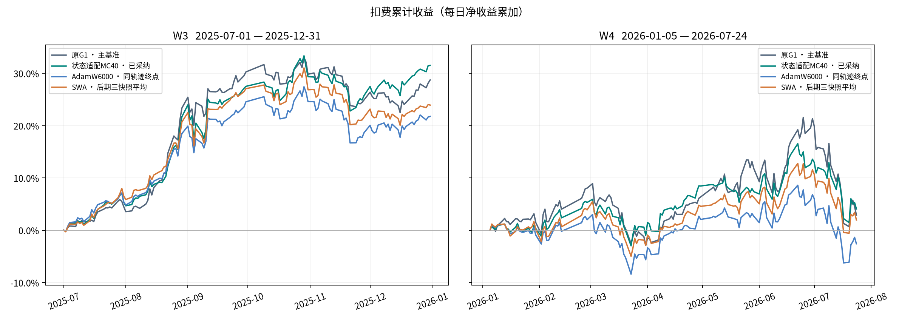
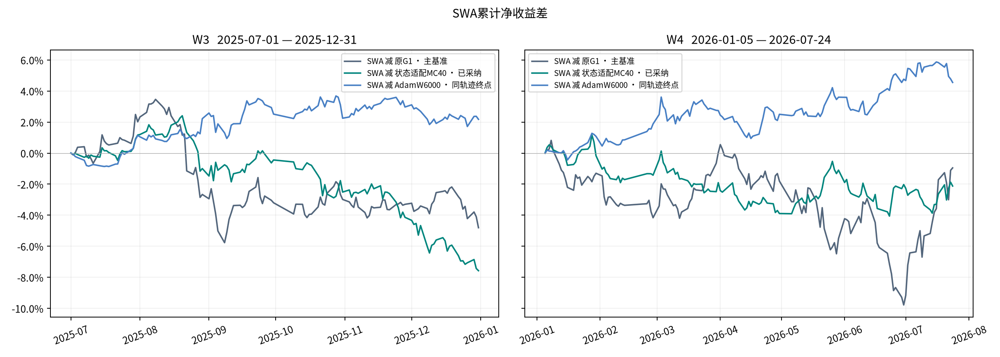
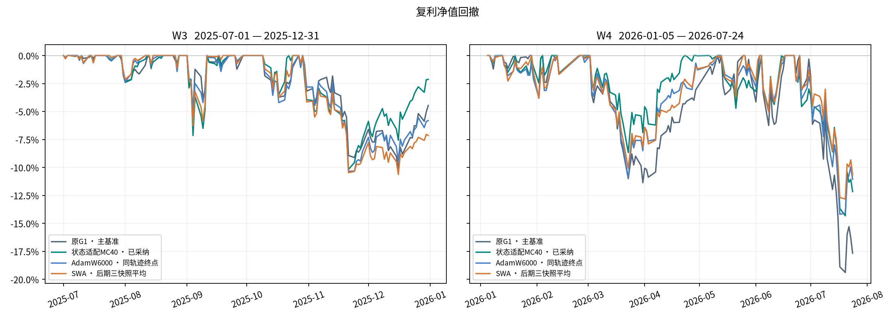

# MC40同轨迹权重平均实验报告

dev-debian已完成两窗回测及独立复算。SWA在W3和W4均跑赢同轨迹6000步终点，两窗扣费累计收益和夏普均低于原G1和已采纳的MC40。收益与风险门槛均未通过，本轮维持MC40。

seed100单一AdamW轨迹的5000、5500、6000步适配器各占1/3，共107712个参数。推理使用42和100两流各20路径。原G1为主基准，已采纳MC40为参照，AdamW6000用于判断平均操作的增量。

| 窗口 | 模型 | 净累计 | 复利 | 夏普 | 最大回撤 | 总成本 | 日均换手 |
|---|---|---:|---:|---:|---:|---:|---:|
| W3 | 原G1 · 主基准 | 28.7302% | 31.8325% | 2.7673 | -10.1962% | 2.1937% | 14.0828% |
| W3 | 状态适配MC40 · 已采纳 | 31.4992% | 35.3499% | 2.8668 | -10.1722% | 2.1472% | 13.7875% |
| W3 | AdamW6000 · 同轨迹终点 | 21.7499% | 23.1996% | 2.3217 | -10.3445% | 2.1172% | 13.5969% |
| W3 | SWA · 后期三快照平均 | 23.9254% | 25.7556% | 2.3955 | -10.6325% | 2.1380% | 13.7283% |
| W4 | 原G1 · 主基准 | 2.9072% | 0.7888% | 0.1930 | -19.3894% | 2.2193% | 13.3949% |
| W4 | 状态适配MC40 · 已采纳 | 4.0769% | 2.7419% | 0.3360 | -14.3241% | 2.3810% | 14.3605% |
| W4 | AdamW6000 · 同轨迹终点 | -2.5964% | -3.8223% | -0.2202 | -14.1857% | 2.2564% | 13.6163% |
| W4 | SWA · 后期三快照平均 | 1.9548% | 0.6759% | 0.1669 | -12.8254% | 2.3647% | 14.2628% |

W3为2025-07-01至2025-12-31，共126日/37223个有效股票日期格。W4为2026-01-05至2026-07-24，共134日/39563格。主指标为每日净收益累计和，复利与最大回撤含初始净值1，夏普按252个交易日和样本标准差计算。Top50/drop5/hold5、次日开盘、1亿元账户、买费0.001/卖费0.0015/最低5元、CSI300历史股票池。涨跌幅pctchange/100按统一±9.5%简化限制。

| SWA减参照 | 扣费累计差（百分点） | 95%配对区间（百分点） |
|---|---:|---:|
| W3/G1_original | -4.8047 | [-18.1786, +5.5533] |
| W3/MC40 | -7.5738 | [-15.5036, +0.7798] |
| W3/AdamW6000 | +2.1755 | [-2.8493, +7.2907] |
| W4/G1_original | -0.9523 | [-14.3431, +14.9757] |
| W4/MC40 | -2.1221 | [-7.8801, +4.3085] |
| W4/AdamW6000 | +4.5512 | [-1.7388, +10.5029] |

与同轨迹终点相比，W4的扣费累计收益从−2.60%升至+1.95%，最大回撤从−14.19%收窄到−12.83%。W3的收益提高2.18个百分点，最大回撤从−10.34%略加深至−10.63%。这两项收益增量的区间都跨零。W4的SWA回撤也浅于MC40，但其夏普为0.17，低于MC40的0.34。

20日配对循环块，5000次、seed100。单训练seed，开发窗口已反复查看，区间未校正多重探索。

固定2025H1缓存正常CE（越低越好），同一eval_seed=103100。

| 权重 | CE |
|---|---:|
| MC40 | 2.448015 |
| 5000 | 2.349761 |
| 5500 | 2.339174 |
| 6000 | 2.321385 |
| SWA | 2.328026 |

权重SHA `4fa52134a6c69fa84a33fab9e7443c01bebe7713c209424bc52553bd20527415`。协议SHA `11b9544188a1e5bf254fc38598da0278f393bc5f56ae83194c4d7b22a0b9cdca`。原始快照与训练轨迹身份见protocol.json，独立逐张量平均核对见diagnostic.json。实验分支codex/mc40-swa-20261103，入口 `python -m state_adapter.mc40_swa`。

## 交付复核

本机按三份源快照的冻结哈希和轨迹身份，独立复算12个张量的107712个参数，平均结果逐值一致。独立复核4份双流信号的原始日期及股票集合、有限格和逐值合流，核验2个账户的逐股损益、成交费、现金与净值。8组指标及累计收益端点、6个配对区间均与报告一致。532条行情守卫记录均在2026-07-24或以前。GPU预算账本结算约4.60小时，上限6小时。核验明细与复算入口见[审计结果](../artifacts/experiments/mc40_swa_20261103/local_final_audit.json)和[复算脚本](../artifacts/experiments/mc40_swa_20261103/verification/local_delivery_recheck.py)。
