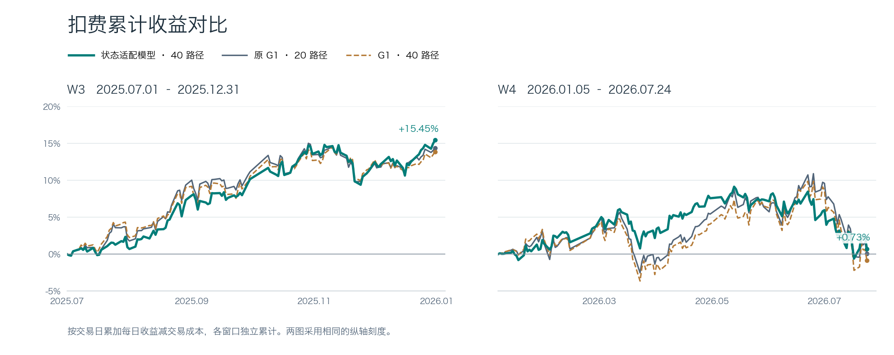

# 已采纳模型 · 状态适配 MC40

> **2026-11-02纠偏提示：本文为旧成交单位口径的历史记录。** 原引擎将涨跌金额当收益率判断价格限制，旧收益数字及其优劣结论不能作为当前依据，旧运行入口也仍复现旧口径。请以[统一纠偏报告](成交限制单位纠偏与冻结方案复核报告_20261102.md)为准；原始记录保留追溯。

2026-11-01，项目采纳单时点状态适配 MC40，作为当前选股预测方案。复现版本在 `dev-debian` 的 `codex/state-mc40-20261101`，提交 `9e969d90062f8aae39903dc1fd1ae614922f6179`。同名 MC40 的 G1 对照仅增加采样预算，以下表格将两者分别列出。

| 窗口 | 指标 | 原 G1（20 路径） | G1（40 路径） | 已采纳模型（40 路径） |
|---|---|---:|---:|---:|
| W3 | 扣费累计收益 | 14.4018% | 13.8868% | 15.4497% |
| W3 | 年化夏普 | 2.312 | 2.211 | 2.726 |
| W4 | 扣费累计收益 | 0.0805% | -0.8577% | 0.7321% |
| W4 | 年化夏普 | 0.009 | -0.086 | 0.097 |

W3 为 2025 年下半年，共 126 个交易日。W4 为 2026 年初至 7 月 24 日，共 134 个交易日。累计收益为逐日 `return - cost` 之和。夏普按窗口独立计算，采用 `sqrt(252) × 日净收益均值 / 日净收益样本标准差`，无风险利率取 0。[逐日净收益原表](实验档案/20261101/daily_net_returns.csv)



模型冻结 G1 主干与 tokenizer，仅在最后两层加入以个股历史波动为条件的低秩残差。使用训练 seed100 的第 3,000 步权重。每个决策日分别以 seed42 和 seed100 各生成 20 条十日路径，再等权合并预测信号。三组都沿用沪深 300 点时成分、次日开盘成交、Top50/drop5/最短持有5日和相同的交易成本。

40 路径合并是在查看两个单流结果后提出的。相对原 G1 的配对收益差 95% 区间，W3 为 [−3.99, +5.99] 个百分点，W4 为 [−11.55, +11.88] 个百分点。采纳依据是这两个历史窗口的表现，独立前向稳健性仍待验证。

## 复现与来源

远端工作树为 `/home/user/workspace/Kronos-state-mc40`。日常预测入口是 `state_adapter.mc40.load_predictor()` 和 `score_day()`。适配器权重 SHA256 为 `d208a8b9f5359aa81bd6cfff473bf9aae193f0b37542e92b7ae39d00c649c402`。远端完整报告和相关研究分支见[研究分支索引](研究分支索引_20261101.md)。

```bash
cd /home/user/workspace/Kronos-state-mc40
/home/user/miniconda3/envs/quant/bin/python -m state_adapter.mc40 --stage replay
```
