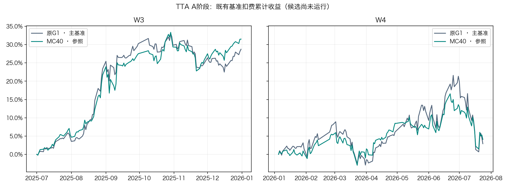

# MC40测试期适配A阶段核查报告

2026-11-04。已在dev-debian执行A阶段的数据前提审计，历史可用时间和复权版本门禁未通过。当前生产接口不足以证明某个值在历史发行时点已可见，B阶段两标量适配尚未启动。原G1为主基准，MC40为参照。

## 实际核查与证据

查询仅涉及DolphinDB元数据，真实行情行读取数为0。已检查生产`QlibFeaturesDay/Features`、可见旁路`QlibFeaturesDayTest/Features`和`QlibInstruments/csi300`的实际schema，并检查可见数据库目录。两张Features表均未见available_at、发布/入库时间、修订或版本字段。历史池表有代码和起止日期，但没有成员变更记录的发布时间。证据为[元数据审计](../artifacts/experiments/mc40_tta_a_20261104/metadata_audit.json)。该结论限定于本次已连接接口和可见表，尚未核查独立外部历史备份。

后端`ddb_features.py`纯字段路径按`date between pair(start,end)`读取当前表，未见as-of发布版本筛选。`schemas.py`把价格映射为后复权OHLC，`factor`映射为后复权因子。字段定义确认了复权类型，但不能提供“这个版本的因子当时何时可用”的证据，也不能重建当时发布的历史修订链。`ddb_operator.py`支持按code/date写入或upsert，这本身不证明生产库实际覆写历史，仅说明此入口未展示历史版本保留契约。相关源文件SHA已归档。

| 门禁 | 当前结果 | 影响 |
|---|---|---|
| 历史字段available_at | 未通过，当前表无证据字段 | 无法核验前日18:00标签截止 |
| 复权历史版本与起点坐标 | 未通过，只有当前因子及后复权值 | 需要原始价格/公司行动及版本链或发行时快照 |
| 池成员发布时点 | 未通过，只有成员起止区间 | 事件生效日不能替代信息可见时点 |
| 全局2026-07-24封存守卫 | 合成调用通过 | 请求超过封存线时传给底层的末日被限制 |
| 逐发行时点读前守卫 | 现有接口未满足 | 需要新增动态模拟时钟的边界约束 |
| a=1等价、梯度隔离、截断历史及断点集成测试 | 待执行 | 数据前提不齐，未启动模型回放 |

合成探针直接调用现有`bounded_features`，以2025-07-01为模拟决策日，2025-07-15的请求仍被传给假数据源。另一个超过封存线的请求被截断到2026-07-24。测试只访问假数据，未读取7月25日之后的行情。证据为[守卫探针](../artifacts/experiments/mc40_tta_a_20261104/guard_probe.json)。这说明全局封存规则有效，但还需独立的逐决策时点规则。

## 收益与图表状态

TTA候选的净累计、复利、夏普、回撤、费用与换手均为“未运行”。以下仅为已完成研究的基准背景，使用已归档日报独立累加净收益，图中没有TTA候选曲线。

| 已有模型 | W3扣费累计 | W4扣费累计 |
|---|---:|---:|
| 原G1 | 28.7302% | 2.9072% |
| 状态适配MC40 | 31.4992% | 4.0769% |

W3范围为2025-07-01至2025-12-31，W4为2026-01-05至2026-07-24。背景日报沿用已纠偏的pctchange/100口径，累计为sum(return−cost)。该图仅帮助识别主基准和参照，不能用于推断TTA有效性。

## 继续执行所需证据

需要可查询历史版本的数据源或历史备份，至少能绑定每个原始价格/成交字段、复权因子或公司行动、历史股票池记录的事件时间、可用时间、版本及修订有效区间。若另有供应商发布时间契约与不可变的发行快照，可据此核查是否满足设计。只有一份当前最终值表、或人为赋值“次日可用”，不足以通过既定门禁。

获得上述来源后，先验证18:00截止及分红拆股样例，再执行逐时点读取限制和合成未来置换、a=1复现、两标量梯度隔离与恢复测试。各项通过后再启动冻结配置的两标量在线回放和完整收益评估。

当前结果属于A阶段前提审计未通过，后续工程与模型验收保持待执行。研究分支为dev-debian的`codex/mc40-tta-20261104`，工作树`/home/user/workspace/Kronos-mc40-tta`。本轮没有GPU模型计算，所有线上数据操作均为只读元数据查询。
