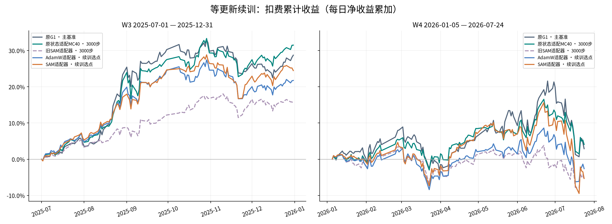
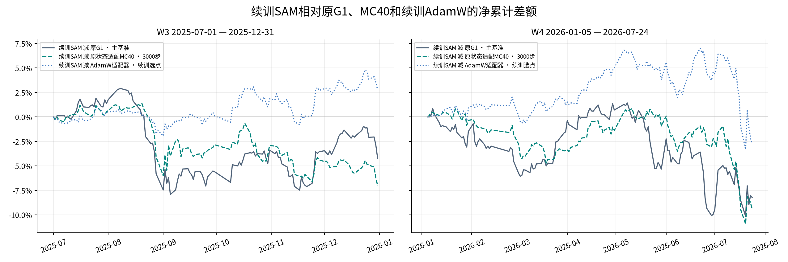
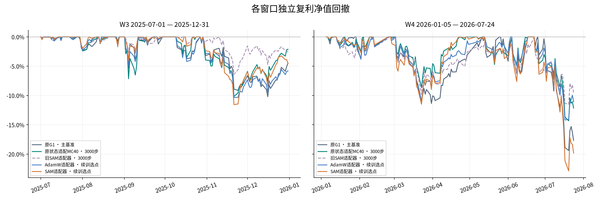
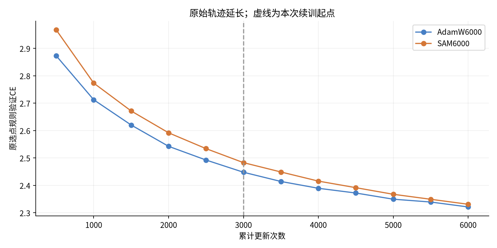

# SAM与AdamW等更新续训报告

两臂在dev-debian各追加3000次更新后，SAM在验证损失上追近AdamW，但两种6000步模型的扣费累计收益在W3和W4都低于原G1和已采纳的状态适配MC40。本轮维持MC40。

只改变额外训练步数；原G1为主基准、原状态适配MC40为参照。SAM/AdamW各追加3000更新，前者每步两次前后向，**同更新次数而非同计算预算**。旧SAM3000保留用于区分续训效应；AdamW续训选点不改名为原MC40。

| 窗口 | 模型 | 净累计 | 复利 | 夏普 | 最大回撤 | 总成本 | 日均换手 |
|---|---|---:|---:|---:|---:|---:|---:|
| W3 | 原G1 · 主基准 | 28.7302% | 31.8325% | 2.7673 | -10.1962% | 2.1937% | 14.0828% |
| W3 | 原状态适配MC40 · 3000步 | 31.4992% | 35.3499% | 2.8668 | -10.1722% | 2.1472% | 13.7875% |
| W3 | 旧SAM适配器 · 3000步 | 15.5759% | 16.3743% | 2.4428 | -6.3804% | 2.1488% | 13.7977% |
| W3 | AdamW适配器 · 续训选点 | 21.7499% | 23.1996% | 2.3217 | -10.3445% | 2.1172% | 13.5969% |
| W3 | SAM适配器 · 续训选点 | 24.4765% | 26.7250% | 2.7773 | -11.5566% | 2.1180% | 13.6020% |
| W4 | 原G1 · 主基准 | 2.9072% | 0.7888% | 0.1930 | -19.3894% | 2.2193% | 13.3949% |
| W4 | 原状态适配MC40 · 3000步 | 4.0769% | 2.7419% | 0.3360 | -14.3241% | 2.3810% | 14.3605% |
| W4 | 旧SAM适配器 · 3000步 | -5.6752% | -6.5220% | -0.5306 | -11.5024% | 2.3219% | 14.0072% |
| W4 | AdamW适配器 · 续训选点 | -2.5964% | -3.8223% | -0.2202 | -14.1857% | 2.2564% | 13.6163% |
| W4 | SAM适配器 · 续训选点 | -5.3088% | -7.2723% | -0.3428 | -22.8733% | 2.3268% | 14.0375% |

W3为126日/37223有限格；W4为134日/39563有限格。sum(return−cost)为净累计，不是年化收益；复利prod(1+r)−1，夏普sqrt252×mean/std(ddof1)，MDD包含初始NAV1。独立窗口共享纵轴。Top50/drop5/hold5、次日open、买费.001/卖费.0015/最低5、资金1亿元、CSI300 PIT均不变。pctchange/100对比±.095的日频close限价是研究简化，不是完整现实执行。

## 核心对照及配对不确定性

| 窗口/比较 | 净累计差（百分点） | 95%配对区间（百分点） |
|---|---:|---:|
| W3/SAM6000-AdamW6000 | +2.7266 | [-5.7500, +10.9675] |
| W3/SAM6000-SAM3000 | +8.9006 | [-6.6294, +22.5801] |
| W3/AdamW6000-MC40 | -9.7493 | [-16.6341, -3.0241] |
| W3/SAM6000-G1_original | -4.2537 | [-23.7273, +12.5607] |
| W3/SAM6000-MC40 | -7.0228 | [-18.1670, +2.7415] |
| W3/AdamW6000-G1_original | -6.9803 | [-21.7276, +3.6938] |
| W4/SAM6000-AdamW6000 | -2.7124 | [-21.0015, +12.1418] |
| W4/SAM6000-SAM3000 | +0.3664 | [-26.2734, +23.0221] |
| W4/AdamW6000-MC40 | -6.6733 | [-14.2732, +1.7368] |
| W4/SAM6000-G1_original | -8.2159 | [-23.2991, +8.1303] |
| W4/SAM6000-MC40 | -9.3857 | [-24.2326, +4.5816] |
| W4/AdamW6000-G1_original | -5.5035 | [-21.7278, +13.4964] |

区间为同日期日净收益差、20日循环块bootstrap、5000次seed100；不修正反复查看历史窗口/多次探索，不可套用于Sharpe或MDD。两窗收益均超过原G1及原MC40为历史收益门槛；两窗夏普不低于MC40且MDD幅度不大于MC40为风险兼容门槛，分别判断。

| 候选 | 历史收益门槛 | 风险兼容门槛 |
|---|---|---|
| AdamW适配器 · 续训选点 | False | False |
| SAM适配器 · 续训选点 | False | False |

## 是否支持训练不足解释

固定seed103100诊断仅用于解释，不参与选点。原选点保留每500步eval_seed=100100+step规则与父3000最佳点。末段仍下降不等于已收敛；训练更久带来的变化也不能全归因于优化器机制。

| 实验臂/检查点 | 步数 | 固定训练probe CE | 固定验证CE |
|---|---:|---:|---:|
| control/parent3000 | 3000 | 2.312575 | 2.448015 |
| control/best | 6000 | 2.209741 | 2.321385 |
| control/final6000 | 6000 | 2.209741 | 2.321385 |
| sam/parent3000 | 3000 | 2.347375 | 2.483085 |
| sam/best | 6000 | 2.220188 | 2.331213 |
| sam/final6000 | 6000 | 2.220188 | 2.331213 |

训练probe是<=2024-12-31语料按seed20261103抽取的256窗口；验证使用旧固定2048个2025H1窗口。时期/抽样分布不同，train/val差不能作为同分布过拟合的单独证据。

固定验证损失方面，AdamW下降0.126631，SAM下降0.151872。SAM相对AdamW的差距从0.035069缩至0.009828，缩小约72%。两臂的最佳验证点都在第6000步。

| 优化器 | 5000步验证CE | 5500步验证CE | 6000步验证CE | 最后两段各500批的平均未扰动训练CE |
|---|---:|---:|---:|---|
| AdamW | 2.349725 | 2.339408 | 2.321416 | 2.19091 → 2.18643 |
| SAM | 2.367660 | 2.349431 | 2.331226 | 2.20725 → 2.19913 |

最后1000步的三个验证点继续下降，尚未观察到平台。表中验证点沿用原选点规则，随机种子随步数变化。固定种子的3000与6000步比较见上表。

**交易结果只部分支持训练不足的解释。** SAM续训后相对旧SAM的扣费累计收益在W3提高8.90个百分点，在W4仅提高0.37个百分点。W4复利收益从−6.52%降至−7.27%，最大回撤从−11.50%加深至−22.87%。AdamW续训后相对其3000步父版本MC40的净累计收益分别下降9.75和6.67个百分点。因此，W3里新SAM超过新AdamW既有SAM自身改善，也有AdamW续训后表现转弱的影响。两种6000步模型的直接对照在W3与W4方向相反，两窗的95%配对区间均跨零。

## 恢复、身份、边界与限制

两臂从各自latest.pt完整恢复12组optimizer动量/step及全部RNG，未重置optimizer。两次恢复第3001步逐值一致。迁移只在新副本绑定协议/config并保留父SHA；原文件不改。每500步保存当前adapter快照，3500..6000全保留。

- AdamW6000：best step=6000，原选点CE=2.321416467，权重SHA `ec8668b06f16453d7421a92e8bcb9c6b8c900f8e7487a73f76ad7fedadfb39a0`；父完整checkpoint SHA `3b715726b8dfbc823ec9bf7cdbf96606c8bb988c78d66ad7f990a1b12d940f27`。
- SAM6000：best step=6000，原选点CE=2.331226334，权重SHA `fdb342ad9c7d726d428bb5c8ec742aefc3c3b1aa3e13b8238690b7a2fa2018ca`；父完整checkpoint SHA `bd064716e87707224c8bab1732c8f992180d9b87f616b4a37d387565d1cc6c46`。

新协议SHA `543a2d3133152ab196f0f3ef84ee0d20bc5358aee92d40de123ba3fe65fd9d79`；底座hash `b16a609e4f8a9828a93720ebaa00f95437e64c557b4366b8675d110a65b05636`；cache SHA `99eb3d1b18d06015759c6eb8ed3fba7ebedbb8ec722e4e730e66eab975360eb2`。两候选推理seed42/100各20路径、L90/H10/T1/top_p.9/top_k0/chunk32/clip5/maxcontext512不变。

封存守卫在真实行情读取前记录/拒绝越2026-07-24请求，本轮审查到1064条守卫记录。新预算GPU12h/墙钟16h从freeze开始累计不重置；当前GPU账本已结算34786.2秒。旧实验预算未改。

单训练seed100、同更新次数非等计算、重复查看W3/W4，均限制泛化推断。该固定追加预算没有授权无限续训或按W3/W4改rho/lr。未自动采纳，未合并实验代码。

分支codex/sam-continuation-20261103；入口`python -m state_adapter.sam_continuation --stage all`。protocol/迁移/smoke/训练/coverage/账户complete记录逐层绑定身份；原始日期与股票集合先核验后才对齐。相关测试、独立审查、源文件SHA及主协调器最终独立复核随产物归档。

## 独立复算与交付

已从原始日报独立复算5个模型、2个窗口共10组收益与风险指标，并核对累计曲线端点。8份原始推理流共1040项，原始日期、股票集合、有限值掩码与原G1相同，双流等权合成逐值一致。四个新账户从持仓和成交独立复算了股数变化、逐股损益、费用、现金和净值，12组配对收益差区间复算一致，1064条行情守卫记录的实际结束日均不晚于2026-07-24。

工程审查发现的快照恢复、训练进程退出检测、部分信号文件校验问题均已修复并经54项相关测试验证。推理初次启动时缺少新工作树的数据源配置链接，修复后从已冻结的训练权重继续，预算累计包含失败阶段。资源守卫按计划暂停并恢复推理。可复核 [独立核验结果](../artifacts/experiments/sam_continuation_20261103/local_final_audit.json) 和 [复算脚本](../artifacts/experiments/sam_continuation_20261103/verification/local_delivery_recheck.py)。
