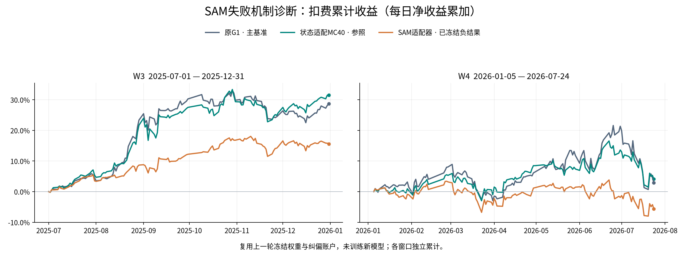
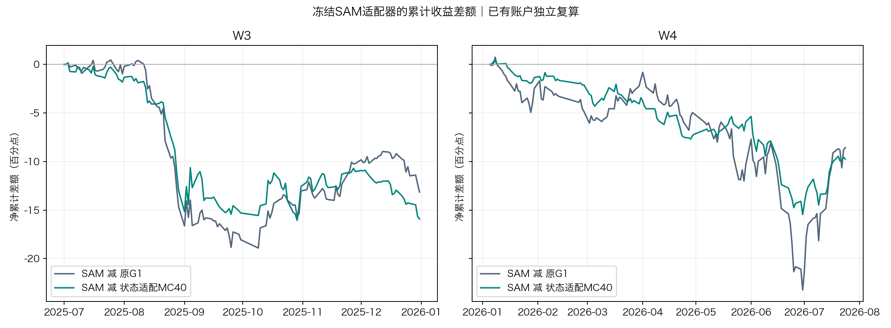
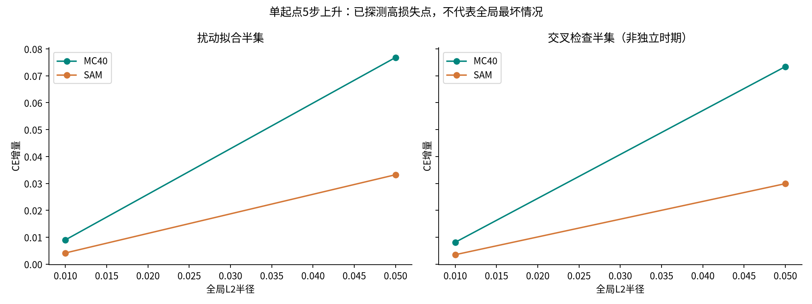
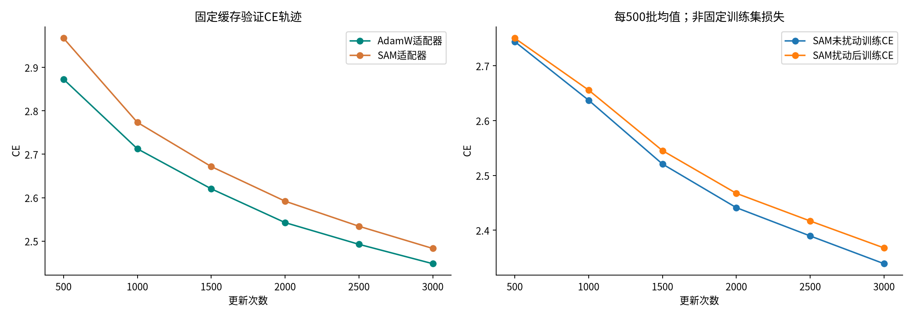
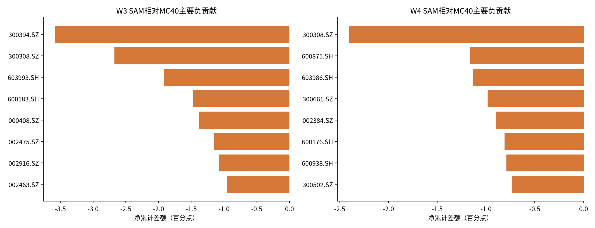

# SAM失败机制诊断报告

本轮已在dev-debian完成冻结权重失败机制诊断：SAM适配器在本次梯度导向扰动检查中更稳健，但正常预测损失、两窗收益和夏普均不如状态适配MC40；现有证据不足以支持直接启动全主干SAM–AdamW训练，建议暂不启动。该结论不等于证明主干SAM无效。

本轮未改变底座、适配器、预测头、推理路径或组合规则，训练更新次数为0、行情数据库查询为0。原G1为主基准、状态适配MC40为参照；SAM是上一轮冻结负结果。下图和收益表来自已核验的原账户日报，本次只独立复算与归因，不是新模型回测。

| 窗口 | 模型 | 净累计 | 复利 | 夏普 | 最大回撤 | 总成本 | 日均换手 |
|---|---|---:|---:|---:|---:|---:|---:|
| W3 | 原G1 | 28.7302% | 31.8325% | 2.7673 | -10.1962% | 2.1937% | 14.0828% |
| W3 | 状态适配MC40 | 31.4992% | 35.3499% | 2.8668 | -10.1722% | 2.1472% | 13.7875% |
| W3 | SAM适配器 | 15.5759% | 16.3743% | 2.4428 | -6.3804% | 2.1488% | 13.7977% |
| W4 | 原G1 | 2.9072% | 0.7888% | 0.1930 | -19.3894% | 2.2193% | 13.3949% |
| W4 | 状态适配MC40 | 4.0769% | 2.7419% | 0.3360 | -14.3241% | 2.3810% | 14.3605% |
| W4 | SAM适配器 | -5.6752% | -6.5220% | -0.5306 | -11.5024% | 2.3219% | 14.0072% |

W3为2025-07-01至12-31，126交易日/37223有限股票日期格；W4为2026-01-05至07-24，134日/39563格。净累计为sum(return−cost)，复利为prod(1+r)−1，夏普sqrt(252)×mean/std(ddof=1)，MDD含初始NAV=1。Top50/drop5/hold5、次日open；买费.001、卖费.0015、最低5元，1亿元账户；CSI300 PIT。限价使用pctchange/100与±.095比较，日频close判限仍为研究简化。SAM相对原G1净累计差W3 -13.1543个百分点、W4 -8.5824个百分点。

## 1. SAM局部稳健性确实改善，但正常损失变差

在固定2025H1的2048窗口cache上，两臂旧正常CE逐值复现。按原批次编号拆成1024窗口拟合扰动和1024窗口交叉检查；保留完整批次顺序与共同随机流，防止更换抽样噪声。

| 模型 | 正常完整CE | 粗token CE | 细token CE | rho=.01交叉半集CE增量 | rho=.05交叉半集CE增量 |
|---|---:|---:|---:|---:|---:|
| 原G1 | 3.034391 | 3.574367 | 2.494416 | 未扰动 | 未扰动 |
| 状态适配MC40 | 2.448015 | 3.622434 | 1.273597 | +0.008118 | +0.073412 |
| SAM适配器 | 2.483085 | 3.608152 | 1.358018 | +0.003501 | +0.029906 |

SAM的正常CE比MC40高0.035069：粗token损失改善0.014283，细token损失恶化0.084421，两者取均值得到总差。**损失差主要来自细token预测；不能把细token改善/恶化直接等同于收益方向预测准确率。**

在本次查找到的扰动方向上，SAM交叉检查半集的CE增量比MC40低约57%（.01）和59%（.05）。rho=.05时，完整缓存扰动后的绝对CE：MC40为2.523125，SAM为2.514650；rho=.01时则为2.456582和2.486910，SAM仍更差。说明存在正常拟合与该尺度邻域稳健性的权衡，不能只报告增量而忽略起始损失，也不能挑有利半径宣布泛化胜出。

rho=.05交叉半集粗/细头条件logits KL：MC40为0.008669/0.044472，SAM为0.003234/0.016311。输出分布变化也较小，但这是共同随机流下对应条件logits的差，不是完整生成路径分布KL。

扰动只作用既有107712个adapter参数。零起点，第一次沿梯度走完整半径，随后4步按rho/4上升并投影，保留包含原点在内拟合CE最高的已观测点。全部路径、tensor扰动/权重范数在geometry.json。MC40 rho=.05最后层up权重相对扰动约0.917%，SAM约0.470%；各层尺度不同，不能把局部敏感性差全部解释为普适泛化机制。单起点5步得到的是已探测高损失点，不是全局最大值；非teacher forcing下离散粗token分支可能跳变，梯度仅描述当前分支。

原先随机方向诊断rho=.05的平均CE增量只有MC40约0.0000237、SAM约-0.00000024。此次梯度导向检查揭示更大的敏感性，因此上一轮的随机方向检查不足以排除尖锐方向。

## 2. 现有训练轨迹不能证明已经收敛或发生过拟合

两臂每500步共6个验证点，SAM始终落后；两臂最佳都在预算终点3000步，且末500步CE仍下降：MC40下降0.044613，SAM下降0.051153。能确认的是相同更新次数下SAM正常验证拟合更差、局部敏感性更低；尚不能区分需要更多更新、正则化权衡或其他优化因素。

SAM逐批未扰动/扰动训练损失按500批汇总在sam_training_blocks.csv。原控制没有对应的逐批训练损失，历史中间检查点仅保留验证日志而未全部保留权重，所以不能补造对齐的训练—验证gap或中间权重几何轨迹。两个训练臂原来同为3000更新，SAM每步两次前后向，并非等计算量。

## 3. 收益差来自股票贡献变化，费用差很小

| SAM相对MC40 | W3 | W4 |
|---|---:|---:|
| 毛收益差（百分点） | -15.9217 | -9.8113 |
| 成本差（百分点；正表示更贵） | +0.0016 | -0.0591 |
| 净收益差（百分点） | -15.9233 | -9.7521 |
| 夏普差 | -0.4240 | -0.8667 |
| 对称分解：均值项 | -1.9732 | -0.8578 |
| 对称分解：波动项 | +1.5492 | -0.0088 |

W3降低波动带来的夏普改善，抵不过均值下降；W4平均收益转负，不能认为降低波动必然提高夏普。分解采用对称公式：均值项=sqrt(252)×Δμ×(1/σ候选+1/σ参照)/2，波动项=sqrt(252)×(μ候选+μ参照)×Δ(1/σ)/2，两项精确相加为夏普差。它是描述性恒等式，不是因果估计。

W3年化波动从21.9751%降至12.7525%，日均HHI从0.02553降至0.02343，平均最大单股权重从6.00%降至4.62%。平均现金比例为1.4149%与1.4556%，未见主要靠大幅空仓降风险的迹象。W4平均最大单股权重从4.65%降至4.42%，现金1.5450%与1.5071%。集中度统计仅使用有持仓的125/133日；现金统计含首日全现金。

W3最大的三个净贡献差为300394.SZ -3.5798个百分点、300308.SZ -2.6733个百分点、603993.SH -1.9211个百分点，合计-8.1742个百分点。W4前三为300308.SZ -2.4030、600875.SH -1.1617、603986.SH -1.1288个百分点，合计-4.6935个百分点。这些是候选与参照在各自实际持仓及成交下的贡献差，不能读作股票自身亏损或完全没买到。

W3最大负差日期2025-08-28（-2.3625个百分点）、09-11（-2.1852）；W4为2026-06-02（-1.9079）、06-15（-1.4456）。完整逐股/逐日差额均附CSV。

额外按cov(每股净贡献差, 两组合净收益之和)拆分方差差，各股之和与组合方差差残差低于1e-12。这有助定位收益与风险改变集中在哪些股票，但没有完整历史行业、市值或完整股票池事前波动率暴露，不声称已经识别行业/高波动风格因果。

SAM对MC40日均排名相关为W3 0.8136、W4 0.8761，Top50重合率66.32%/72.55%；对原G1分别为0.5354/0.5984、45.62%/49.84%。冻结信号逐日排名相关和Top50重合另存signal_comparison_*.csv；两窗均核对原G1/MC40/SAM完整日期与有限股票格。预测排序、持仓路径和收益差构成关联证据，不能由此证明某个token损失变化直接导致某只股票的贡献变化。

## 4. 是否值得直接启动主干配对实验

**本次建议：暂不启动全主干SAM–AdamW训练。** 理由并非SAM完全没有起作用：本次确实发现较低的局部敏感性。缺少的是“这个机制改善了正常预测或经济目标”的桥梁；本轮甚至在较低敏感性下出现细token正常损失恶化和两窗收益下降。将相同正则化动机直接扩大到整个主干，目前依据不足。

这一决定仍保留研究可能性。未来若重开，应先提出主干自身的可证伪瓶颈证据，并用同一G1检查点继续训练的AdamW作为机制对照；不能只比较SAM与未继续训练的G1。训练和诊断口径须预先固定，并在有先导依据后再安排等计算量与跨训练seed确认。本轮不另开参数搜索、不训练任何主干候选。

## 5. 限制、审计与复现

- 单训练seed100，冻结旧推理种子42/100各20路径。原G1主组合保留其既有采样口径；本轮无新采样比较。
- 1024/1024拆分来自已用于选点的同一2025H1缓存，窗口可能重叠，不是未见时间外验证；W3/W4也已被反复查看。这里的描述性机制发现没有独立泛化或显著性背书。
- 原始缓存不含逐窗日期元数据，2025H1边界依赖原构建协议/审计和SHA一致性。此次代码不创建行情provider，不访问2026-07-25及以后行情或标签；只读旧token缓存、信号与账户。
- 首次运行遇到原G1不含适配器、不能调用set_state的工程错误；已补失败测试并修正，只对含适配器模型设置状态，原失败日志保留。失败时间计入新诊断预算，旧SAM实验预算未改。
- 本次GPU任务进程累计耗时约61.4秒，属于任务占用墙钟而非硬件核算GPU活跃秒；新诊断上限1800秒、墙钟7200秒。没有模型训练或策略更改。
- 分支codex/sam-mechanism-20261103，基于62ab50a。原MC40权重SHA d208a8b9f5359aa81bd6cfff473bf9aae193f0b37542e92b7ae39d00c649c402；SAM SHA 9ed6b8d808276dc1b4d0de20646ed61f41c91638cac07700e36f23085a60ef28；cache SHA 99eb3d1b18d06015759c6eb8ed3fba7ebedbb8ec722e4e730e66eab975360eb2。
- 复现入口为`python -m state_adapter.sam_mechanism`与`python -m state_adapter.sam_mechanism_report`；远端Python为`/home/user/miniconda3/envs/quant/bin/python`。该诊断不调用optimizer.step，所有临时参数扰动均恢复。
- 核心证据在artifacts/experiments/sam_mechanism_20261103：geometry.json、summary.json、input_manifest.json、训练轨迹、逐股/逐日差额、原日报、图表与端点。独立复算与审查记录随最终交付追加。

本报告与[上一轮SAM完整收益报告](SAM状态适配器实验报告_20261102.md)共同阅读。实验分支不合并，仅发布文档与证据；不自动采纳新模型。

## 主协调器独立复算

本机从六组原始账户日报独立复算净累计、复利、夏普、MDD、成本、换手、年化波动，核对逐股毛/净/费用、股票贡献差、方差差及Sharpe分解；图端点全部一致。geometry记录与原正常CE一致，半径误差低于1e-7。此步骤是记录与账户的独立复算，不冒称第二次独立GPU实验。证据见local_independent_audit.json及verification/local_recheck.py。

相关测试41项通过；未运行会下载模型或可能访问未封装行情provider的全仓集成测试，以守住封存边界。本轮CPU恢复测试覆盖正常、异常、零半径与梯度/RNG；真实正常CE复现、底座hash、adapter精确恢复门禁通过。

独立新上下文审查未发现Critical/Important问题。保留两项未来复跑防护Minor：诊断runner复用geometry_*.json时没有自动将缓存绑定到当前协议身份；信号先reindex再检验有限格，可能掩盖未来新增的日期/股票。本轮缓存、权重、源码和原CE已实际核验，独立审查还直接核对了未经reindex的原始日期/股票集合完全相同，当前结论不受影响；但改变配置或输入后不能直接复用同一输出目录，未来重跑前需补身份门禁或使用新输出目录。本轮作为冻结一次性研究产物归档，不将其当通用实验调度器。

固定源码审查提交：`2ddc3ed7fa8b27f228d0c976aef5f8eb4eb55401`；远端完整证据归档提交：`2109af2eed045567ba3b3dc07a8aee49cc351146`。
