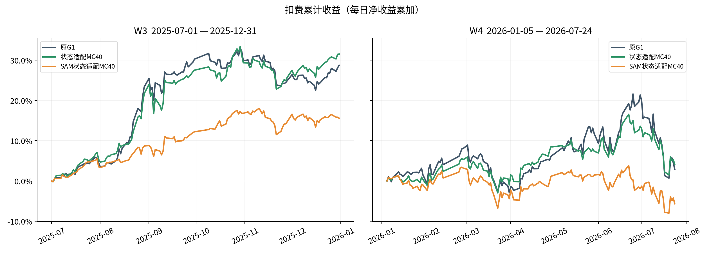
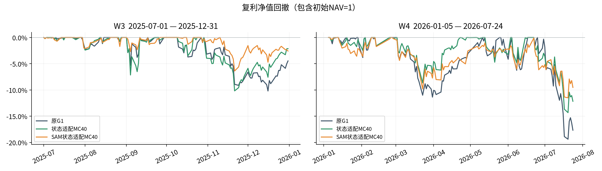
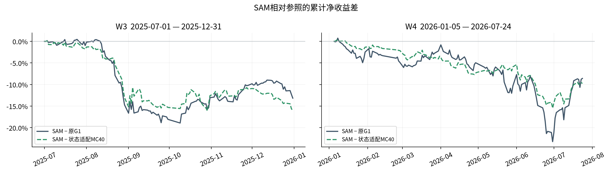

# SAM状态适配器实验报告

实验登记日2026-11-02，计算跨日完成。冻结G1与tokenizer，保留状态适配器结构，仅将适配器训练更新替换为SAM；已完成两窗MC40推理及纠偏口径真实账户回测，未通过两窗历史收益门槛（negative），风险兼容门槛未通过。本轮候选未自动采纳。

改动仅在107712个adapter权重的训练方法。原G1为主基准，状态适配MC40为既有参照；没有新增预测头、日期等权、SWA或测试期适配。

| 窗口 | 模型 | 净累计 | 复利 | Sharpe | 最大回撤 | 总成本 | 日均换手 | 年化波动 |
|---|---|---:|---:|---:|---:|---:|---:|---:|
| W3 | 原G1 | 28.7302% | 31.8325% | 2.7673 | -10.1962% | 2.1937% | 14.0828% | 20.7642% |
| W3 | 状态适配MC40 | 31.4992% | 35.3499% | 2.8668 | -10.1722% | 2.1472% | 13.7875% | 21.9751% |
| W3 | SAM状态适配MC40 | 15.5759% | 16.3743% | 2.4428 | -6.3804% | 2.1488% | 13.7977% | 12.7525% |
| W4 | 原G1 | 2.9072% | 0.7888% | 0.1930 | -19.3894% | 2.2193% | 13.3949% | 28.3303% |
| W4 | 状态适配MC40 | 4.0769% | 2.7419% | 0.3360 | -14.3241% | 2.3810% | 14.3605% | 22.8155% |
| W4 | SAM状态适配MC40 | -5.6752% | -6.5220% | -0.5306 | -11.5024% | 2.3219% | 14.0072% | 20.1134% |

W3 126日/37223有限格；W4 134日/39563有限格，实际2026-01-05起。两窗独立面板共享y轴。主指标为sum(return−cost)，并非年化收益；复利为prod(1+r)−1；Sharpe为sqrt(252)×mean/std(ddof=1)；MDD含初始NAV=1。日均换手为Qlib日报turnover均值（当日成交额/前日账户总值）。所有图表从同一日报复算。

## 相对收益、风险与不确定性

| 窗口 | 参照 | SAM净累计差（百分点） | 95%配对区间（百分点） |
|---|---|---:|---:|
| W3 | 原G1 | -13.1543 | [-42.8756, +11.8341] |
| W3 | 状态适配MC40 | -15.9233 | [-36.3023, +2.1092] |
| W4 | 原G1 | -8.5824 | [-32.1645, +18.4173] |
| W4 | 状态适配MC40 | -9.7521 | [-24.1495, +4.6525] |

历史收益条件为两窗均严格超过原G1及MC40：**False**。风险兼容为两窗Sharpe不低于MC40且MDD幅度不高于MC40：**False**。两项分别判断，不能用W3单窗领先代替跨窗成功。

区间使用日净收益配对差、20日循环块bootstrap、5000次、seed100。它刻画已观察窗口内的时序不确定性，不修正反复查看历史窗口和候选探索造成的选择偏差。即便两项均通过，也只构成单次先导历史证据，不证明状态因果贡献。

## 训练机制与敏感性

原AdamW从零重训3000步，所有adapter tensors最大绝对差0，beststep=3000、CE=2.448015436530113与旧MC40逐值一致。SAM最低未扰动验证CE为2.483084656298161，选点step=3000；每500步的全部记录见training_sam.jsonl。选点没有使用回测收益。

两臂同为3000次AdamW更新；SAM名义训练前向/反向为6000次，控制为3000次，**同更新次数，不是等计算预算**。初始化/窗口均匀采样seed100；固定lr3e−4、betas(.9,.95)、weight_decay=.01、batch64，第二梯度clip1；冻结cache2048个2025H1窗口，目标位置89..98。rho=.05在看SAM W3/W4收益前锁定，非adaptive L2，epsilon=1e−12，不称最优。

每批tokenizer只encode一次，两前向恢复相同CPU/CUDA/Python/NumPy起始随机状态；外部随机流只推进一次。这不保证扰动后的离散token相同。参数在finally精确copy还原，然后一次AdamW.step；weight decay仅一次。

| 权重 | 零扰动CE | rho | CE增量均值 | 最小/最大增量 |
|---|---:|---:|---:|---:|
| 原MC40 | 2.448015437 | 0.01 | +0.000001682 | -0.000016399 / +0.000016391 |
| 原MC40 | 2.448015437 | 0.05 | +0.000023714 | -0.000049151 / +0.000092678 |
| SAM选点 | 2.483084656 | 0.01 | -0.000001732 | -0.000020348 / +0.000017077 |
| SAM选点 | 2.483084656 | 0.05 | -0.000000244 | -0.000096776 / +0.000096031 |

诊断每个非零rho共8个方向，即4个独立全局L2单位方向及其负方向，seed20261102；两幅度使用相同方向。固定eval_seed103100，两次零扰动完全一致。完整CE增量和实际半径见diagnostic_reference.json与diagnostic_sam.json。诊断只读2025H1验证cache，原权重/底座hash/RNG精确恢复。小幅CE变化或局部敏感性降低均不能外推交易收益，也不作为完成经济诊断的门槛。

| 窗口/参照 | 日横截面Spearman均值 | 最小值 | Top50平均重合率 |
|---|---:|---:|---:|
| W3/G1_original | 0.5354 | 0.2187 | 45.62% |
| W3/MC40 | 0.8136 | 0.7125 | 66.32% |
| W4/G1_original | 0.5984 | 0.3041 | 49.84% |
| W4/MC40 | 0.8761 | 0.7602 | 72.55% |

这些排序差异反映冻结SAM权重经同采样预算生成出口后的变化；两窗结果分别报告，不能将训练CE变化解释为收益变化的因果证明。

## 执行口径、身份与复现

训练seed100，推理随机流42/100各20条路径，信号均值0.5/0.5；L90/H10/T1/top_p.9/top_k0/chunk32/clip5/maxcontext512，每日重置seed。日期/股票finite mask与原G1完全一致。

Top50/drop5/hold5，次日open，买费.001、卖费.0015、最低5，资金1亿元，CSI300 PIT。限价判断仅为pctchange/100对比±.095；统一9.5%与日频close判限仍是研究简化。原G1和MC40冻结信号已实际重放，四份纠偏源日报最大误差≤1e−10；未混用旧错误金额change口径。

所有真实行情请求均由market_guard在读取前截断/拒绝，审计保存在inference_market_requests.jsonl和accounts下market_requests.jsonl；2026-07-25以后封存行情未用于本轮。持仓、实际成交、个股日损益及费用残差保存于accounts/{W3,W4}/{G1_original,MC40,SAM_MC40}。

实验分支：codex/sam-adapter-20261102；报告代码版本：`5101a18090efe3fb5733a363b6288494acff3518`。协议canonical SHA：`fee5cb7971e53577da3c792fb03a6207d54b50c7ad5cbcf26ca32e523c1a6cf3`。SAM选点SHA：`9ed6b8d808276dc1b4d0de20646ed61f41c91638cac07700e36f23085a60ef28`。

固定底座hash：`b16a609e4f8a9828a93720ebaa00f95437e64c557b4366b8675d110a65b05636`。验证cache SHA：`99eb3d1b18d06015759c6eb8ed3fba7ebedbb8ec722e4e730e66eab975360eb2`。来源路径及逐文件SHA详见protocol.json，执行版本见execution_version.json，回测complete.json绑定信号与日报SHA。

GPU累计已结算秒：17006.1/21600；墙钟起点：2026-11-02T21:27:51.564471+08:00，固定8h恢复不重置。SAM训练峰值显存1.075GiB；单次训练记录耗时271.2s，失败重启全部计入gpu_budget.json。

复现入口：`OMP_NUM_THREADS=4 OPENBLAS_NUM_THREADS=1 /home/user/miniconda3/envs/quant/bin/python -m state_adapter.sam_run --stage all`。超过冻结预算不可重置后重跑；本入口按身份恢复已有产物。测试命令及真实输出位于verification/，独立代码审查记录见review_gate.json及review.md；任务与修订见execution_ledger.md。

## 限制与待确认事项

单训练seed100、单固定rho，一次有界探索；既有W3/W4已被多次查看，本轮不是未见数据检验。未来确认仍需要跨训练seed、等计算量控制（如6000步AdamW）与独立时期；本轮不自动扩展。没有自动采纳、合并或push，主协调器另行决定研究索引发布。

## 主协调器最终交付复核

基于远端结果提交`62ab50a072411066ae32c10550e831c5660cc428`，独立复算六组指标/累计曲线及真实股数、成交、毛收益、费用、现金和NAV；四组完整随机流的日期/股票有限格与原G1一致，等权合成逐值一致；四项配对循环块区间一致。538条真实行情请求记录未越2026-07-24，候选权重SHA与冻结身份一致，五个独立审查源码SHA未改变。证据为`local_final_audit.json`。

独立代码审查无Critical/Important项，保留一项Minor：前后向计数为有效训练轨迹的名义次数，若未来中断重算，实际开销可能更高，必须以累计预算耗时账报告。本轮两臂训练未发生中断重算。完整审查范围、执行裁定与代价见`review.md`及`execution_ledger.md`，包括不追加rho/SWA/seed或等计算确认、不扩大标准优化器故障事务处理等。

本结果只否定本轮固定rho0.05、seed100、3000步配置的替换价值，不能据此断言所有SAM配置均无效；也不根据这两窗结果继续调参。本次未采纳、未合并实验分支。
