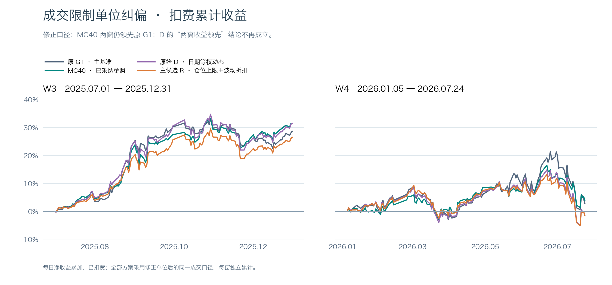
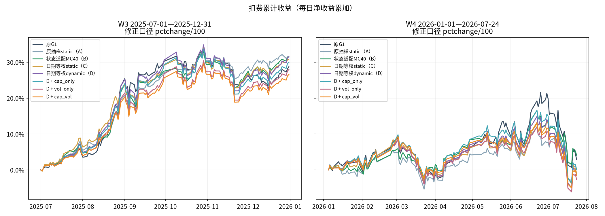
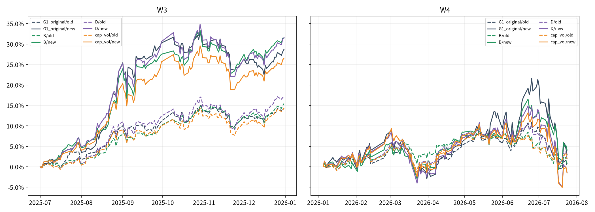
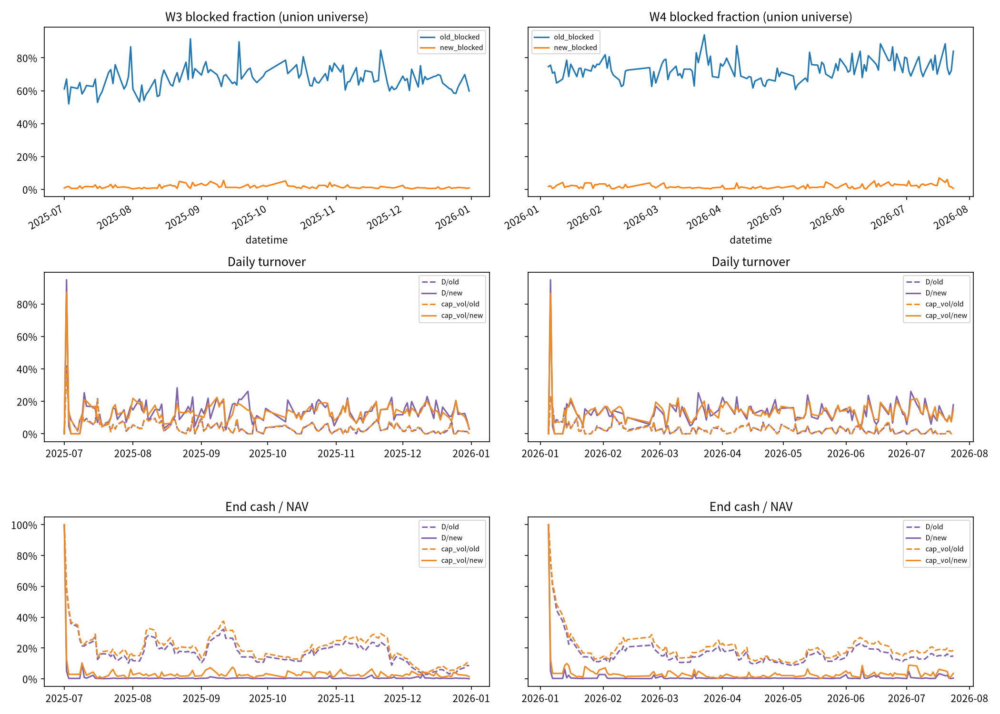
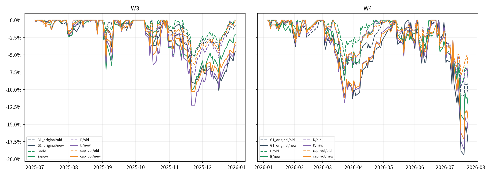

# 成交限制单位纠偏与冻结方案复核报告

**纠偏结论：MC40在修正口径下两窗收益与夏普仍高于原G1；D在W4转为亏损，此前D两窗领先的结论撤回。** 风险约束主候选也未达收益保留门槛。

发现原Qlib将涨跌金额 `$change` 与小数阈值0.095直接比较，原G1、MC40及D风险实验收益结论均受影响；本轮已完成冻结信号的受控执行纠偏，cap_vol固定门槛未通过，不自动采纳任何候选。
W3修正口径cap_vol相对原G1为-2.1542个百分点，相对B为-4.9232个百分点；B相对原G1为+2.7691个百分点。
W4修正口径cap_vol相对原G1为-4.4107个百分点，相对B为-5.5805个百分点；B相对原G1为+1.1698个百分点。

唯一变动在执行层：价格限制使用`$pctchange / 100`。模型底座、预测、冻结信号、CSI300 PIT、Top50/drop5/hold5、次日open、费用和风险规则不变。B是原抽样dynamic已采纳MC40，D是日期等权dynamic，A/C分别是对应static控制。



|口径|窗|臂|扣费累计%|复利%|Sharpe|含初始1 MDD%|成本%|日均换手%|
|---|---|---|---:|---:|---:|---:|---:|---:|
|old|W3|G1_original|14.4018|15.0381|2.3124|-5.1597|0.7422|4.8364|
|old|W3|A|9.7641|9.9934|2.0055|-4.4919|0.7021|4.5997|
|old|W3|B|15.4497|16.3250|2.7264|-5.3090|0.7601|4.9722|
|old|W3|C|18.7514|19.8823|2.4004|-7.6865|0.6627|4.3400|
|old|W3|D|17.1340|17.9832|2.2288|-7.8357|0.6547|4.2972|
|old|W3|cap_only|16.8100|17.6130|2.2043|-7.8198|0.6592|4.3237|
|old|W3|vol_only|14.9053|15.5486|2.2253|-6.4457|0.6597|4.3292|
|old|W3|cap_vol|14.3357|14.9060|2.1680|-6.4088|0.6683|4.3807|
|old|W4|G1_original|0.0805|-0.6691|0.0090|-10.8645|0.4411|2.7591|
|old|W4|A|1.1326|0.5866|0.1480|-8.1568|0.4893|3.0553|
|old|W4|B|0.7321|0.1964|0.0967|-9.5259|0.5756|3.5615|
|old|W4|C|-1.5149|-2.1542|-0.1799|-11.4083|0.4972|3.0953|
|old|W4|D|1.9344|1.2535|0.2254|-9.5609|0.4561|2.8486|
|old|W4|cap_only|2.2916|1.6481|0.2734|-9.0086|0.4624|2.8855|
|old|W4|vol_only|1.1294|0.5678|0.1455|-8.4607|0.4529|2.8269|
|old|W4|cap_vol|1.8964|1.3896|0.2552|-7.9784|0.4668|2.9075|
|new|W3|G1_original|28.7302|31.8325|2.7673|-10.1962|2.1937|14.0828|
|new|W3|A|31.3388|35.6680|3.4850|-6.7409|2.1645|13.8973|
|new|W3|B|31.4992|35.3499|2.8668|-10.1722|2.1472|13.7875|
|new|W3|C|30.6924|34.3960|2.9157|-11.0708|2.2190|14.2434|
|new|W3|D|31.5579|35.2204|2.7048|-12.2608|2.2077|14.1721|
|new|W3|cap_only|29.9479|33.1780|2.6518|-12.0363|2.1965|14.1007|
|new|W3|vol_only|27.9574|30.8420|2.7204|-10.5783|2.1330|13.6956|
|new|W3|cap_vol|26.5760|29.1727|2.7118|-10.3227|2.1259|13.6502|
|new|W4|G1_original|2.9072|0.7888|0.1930|-19.3894|2.2193|13.3949|
|new|W4|A|0.1028|-1.1083|0.0090|-14.2183|2.3451|14.1453|
|new|W4|B|4.0769|2.7419|0.3360|-14.3241|2.3810|14.3605|
|new|W4|C|-0.8529|-2.6197|-0.0614|-16.6831|2.3333|14.0751|
|new|W4|D|-1.4177|-3.1878|-0.1015|-18.5754|2.2095|13.3362|
|new|W4|cap_only|0.0975|-1.6891|0.0070|-18.9302|2.2569|13.6191|
|new|W4|vol_only|-2.6591|-4.1096|-0.2073|-17.0018|2.1900|13.2156|
|new|W4|cap_vol|-1.5035|-2.9486|-0.1191|-17.1611|2.2429|13.5309|

|窗|臂|旧→新累计差pp|Sharpe变化|MDD变化pp|成本变化pp|换手变化pp|
|---|---|---:|---:|---:|---:|---:|
|W3|G1_original|+14.3284|+0.4549|-5.0366|+1.4515|+9.2464|
|W3|A|+21.5747|+1.4795|-2.2490|+1.4624|+9.2975|
|W3|B|+16.0495|+0.1404|-4.8631|+1.3871|+8.8153|
|W3|C|+11.9410|+0.5154|-3.3843|+1.5563|+9.9034|
|W3|D|+14.4239|+0.4760|-4.4251|+1.5530|+9.8749|
|W3|cap_only|+13.1379|+0.4475|-4.2165|+1.5373|+9.7770|
|W3|vol_only|+13.0521|+0.4951|-4.1326|+1.4733|+9.3664|
|W3|cap_vol|+12.2403|+0.5438|-3.9139|+1.4576|+9.2695|
|W4|G1_original|+2.8266|+0.1840|-8.5249|+1.7782|+10.6359|
|W4|A|-1.0298|-0.1390|-6.0615|+1.8557|+11.0900|
|W4|B|+3.3448|+0.2394|-4.7982|+1.8054|+10.7990|
|W4|C|+0.6620|+0.1185|-5.2748|+1.8361|+10.9798|
|W4|D|-3.3521|-0.3269|-9.0145|+1.7534|+10.4875|
|W4|cap_only|-2.1941|-0.2664|-9.9216|+1.7945|+10.7336|
|W4|vol_only|-3.7884|-0.3528|-8.5411|+1.7371|+10.3887|
|W4|cap_vol|-3.3999|-0.3743|-9.1827|+1.7761|+10.6234|

W3为126交易日/37223有限信号格，W4为134日/39563格。Sharpe为sqrt(252)×均值/样本标准差；费用为原引擎cost，换手为原引擎每日turnover。资金1亿，买0.001/卖0.0015/最低5。旧A/C使用冻结日报，其余旧臂均重新对拍；8臂新口径均有真实账户账本。

所有旧实验结果保留为“旧成交口径历史产物，收益结论待本次纠偏对照解释”。此前MC40采纳决定仅保留为历史记录，其旧收益不能作为当前有效依据；当前比较以同口径重放B和原G1为准。

补充源代码定位：所指bridge第387/388行位于指数同步段，不能单凭该两行推断股票同步路径；股票金额单位的直接证据是本次多股票真实字段恒等式及固定样例，完整外部源码SHA/原始片段保留。

字段核查：{"rows": 86060, "stocks": 331, "missing": 328, "amount_exceptions": 0, "return_exceptions": 11790, "false_blocked": 59010, "new_blocked": 1462, "expression_verified": true, "tolerance_amount": 0.011, "tolerance_return": 2e-06}。全窗字段在331股票并集上核查，包含当日不在PIT池中的股票，不能将该比例称为当日可投资池比例。精度异常未丢弃，详见field_exceptions.csv；金额绝对容差0.011元、收益率绝对容差0.000002。异常不等同企业行为已确诊。

固定样例601138.SH在2025-08-14的change=-0.46元，pctchange=-1.0531%；300308.SZ为-12.53元、-4.9722%。旧规则均误禁，新规则允许。固定9.5%仍是研究简化，未同时实现创业板20%或ST规则；close判日频限制仍是原引擎假设，不能声称解决全部执行偏差。原forbid_all_trade_at_limit语义不变。

旧风险not_tradable事件复核：`{"W3/cap_only": {"total": 176, "unit_false_block": 163, "still_blocked": 13, "missing_flags": 0}, "W3/cap_vol": {"total": 308, "unit_false_block": 290, "still_blocked": 18, "missing_flags": 0}, "W4/cap_only": {"total": 202, "unit_false_block": 178, "still_blocked": 24, "missing_flags": 0}, "W4/cap_vol": {"total": 337, "unit_false_block": 301, "still_blocked": 36, "missing_flags": 0}}`。

固定候选门槛：`{"checks": {"W3": {"above_G1": false, "above_B": false, "sharpe": true, "mdd": true}, "W4": {"above_G1": false, "above_B": false, "sharpe": false, "mdd": true}}, "w3_strict_mdd": true}`；失败不调参，不从cap_only/vol_only后验择优。

|窗|2×2对比|累计差pp|循环块95%区间pp|重采样正值比例|
|---|---|---:|---|---:|
|W3|B-A|0.1604|[-8.433923436277782, 8.994011134299038]|0.5148|
|W3|D-C|0.8655|[-5.594109260908471, 8.18063748030347]|0.5770|
|W3|C-A|-0.6464|[-10.32593904746633, 8.548534825021465]|0.4428|
|W3|D-B|0.0587|[-6.89156661785305, 7.434930301625807]|0.4836|
|W3|D-C-B+A|0.7052|[-6.1382468616151895, 7.904892661498077]|0.5834|
|W4|B-A|3.9741|[-3.9659204343584356, 11.567534627991622]|0.8462|
|W4|D-C|-0.5648|[-7.8916629536741425, 6.050511365960322]|0.4616|
|W4|C-A|-0.9557|[-11.68147065794012, 8.773020567277031]|0.4380|
|W4|D-B|-5.4946|[-16.7088337116997, 5.3573701552320445]|0.1724|
|W4|D-C-B+A|-4.5389|[-14.775060004164045, 5.826989038242322]|0.1952|

20日共同日期循环块bootstrap5000次、seed100；仅历史诊断，未多重校正、未独立确认，不外推未来盈利。

|口径|窗|臂|日初最大权重均值%|HHI均值|现金均值%|60日波动暴露|超限股票日|风险减仓计划/成交|300308净贡献pp|300308方差份额|
|---|---|---|---:|---:|---:|---:|---:|---|---:|---:|
|old|W3|D|3.7105|0.01634|18.3555|0.3212|0|0/0|3.9034|11.24%|
|old|W3|cap_vol|2.7675|0.01470|21.1972|0.2888|327|11/11|2.5431|7.32%|
|old|W4|D|3.4936|0.01633|18.0294|0.3523|0|0/0|0.0000|0.00%|
|old|W4|cap_vol|2.8880|0.01472|21.0896|0.3191|356|15/15|0.0000|0.00%|
|new|W3|D|4.2363|0.02233|2.1629|0.4235|0|0/0|2.9283|3.29%|
|new|W3|cap_vol|2.8686|0.01925|4.5851|0.3825|374|172/172|2.2686|2.62%|
|new|W4|D|4.9297|0.02277|2.2257|0.4663|0|0/0|0.7205|0.93%|
|new|W4|cap_vol|2.9228|0.01925|4.5106|0.4361|430|177/177|0.8608|1.35%|

|口径|窗|臂|自身峰日|自身谷日|恢复日|MDD%|
|---|---|---|---|---|---|---:|
|old|W3|D|2025-10-29|2025-11-24|None|-7.8357|
|old|W3|cap_vol|2025-10-29|2025-11-24|None|-6.4088|
|old|W4|D|2026-06-22|2026-07-17|None|-9.5609|
|old|W4|cap_vol|2026-05-13|2026-07-17|None|-7.9784|
|new|W3|D|2025-10-29|2025-11-21|None|-12.2608|
|new|W3|cap_vol|2025-10-29|2025-11-21|None|-10.3227|
|new|W4|D|2026-06-22|2026-07-20|None|-18.5754|
|new|W4|cap_vol|2026-06-22|2026-07-20|None|-17.1611|

W3原D的300308.SZ净贡献由旧口径3.9034pp变为新口径2.9283pp，方差份额由11.24%变为3.29%。该变化说明此前集中度描述受到错误交易锁定及其后续持仓路径影响；不将它解释为该股票的独立因果效应。

W4原D的300308.SZ净贡献由旧口径0.0000pp变为新口径0.7205pp，方差份额由0.00%变为0.93%。该变化说明此前集中度描述受到错误交易锁定及其后续持仓路径影响；不将它解释为该股票的独立因果效应。

超限是cap_vol目标3%×折扣的日末比较；D未施加上限，其超限列不适用。风险暴露、覆盖权重、20/60日波动、逐日现金和逐笔超限原因均见risk_daily.csv和账户risk_summary.json。

旧→新收益变化会计分解及此前受阻交易：`{"W3/G1_original": {"delta_pp": 14.328392641363855, "previously_blocked_trade_count": 723, "previously_blocked_trade_value": 1718922232.6366649, "top5_pp": {"300502.SZ": 2.733366459085758, "300394.SZ": 2.0479440588850926, "603986.SH": 1.5274983026236078, "300308.SZ": 1.395351472859847, "300014.SZ": 1.2832324744309787}, "bottom5_pp": {"601872.SH": -0.7164906979184587, "000630.SZ": -0.5989254540021818, "000983.SZ": -0.590808033520864, "601868.SH": -0.5573809255348551, "002600.SZ": -0.48581164188803194}}, "W3/B": {"delta_pp": 16.049537501692104, "previously_blocked_trade_count": 654, "previously_blocked_trade_value": 1670598576.8231146, "top5_pp": {"300394.SZ": 3.852926337246404, "300308.SZ": 3.131715034788342, "300502.SZ": 2.8909268259157987, "002463.SZ": 1.7473588094800478, "002916.SZ": 1.5646400603735777}, "bottom5_pp": {"601138.SH": -1.9667805747505762, "002074.SZ": -1.1786799739470075, "600176.SH": -0.6476702225921274, "002600.SZ": -0.5627065179039509, "601600.SH": -0.5026952775705638}}, "W3/D": {"delta_pp": 14.423883584596794, "previously_blocked_trade_count": 718, "previously_blocked_trade_value": 1745358531.5578313, "top5_pp": {"002916.SZ": 2.135495156701128, "600362.SH": 1.6917134461980436, "300394.SZ": 1.566704535380577, "300502.SZ": 1.2962431945341022, "603993.SH": 1.0202787976331555}, "bottom5_pp": {"300308.SZ": -0.9751179011549477, "000977.SZ": -0.7538557102682857, "600000.SH": -0.6814628338038099, "601138.SH": -0.5294597459970134, "600588.SH": -0.49639084499253916}}, "W3/cap_vol": {"delta_pp": 12.240297760407111, "previously_blocked_trade_count": 866, "previously_blocked_trade_value": 1579139401.012563, "top5_pp": {"002916.SZ": 1.6448118850521802, "300394.SZ": 1.335341777920965, "600362.SH": 1.2862049684175245, "603993.SH": 1.1654193093210816, "300502.SZ": 1.009334952827356}, "bottom5_pp": {"002466.SZ": -0.39628526929532143, "600000.SH": -0.37852324543266935, "000977.SZ": -0.372935005275251, "601865.SH": -0.35486091401966596, "601138.SH": -0.3142020197331592}}, "W4/G1_original": {"delta_pp": 2.8266152317028768, "previously_blocked_trade_count": 808, "previously_blocked_trade_value": 1636108220.515206, "top5_pp": {"600584.SH": 2.0321701954575158, "603986.SH": 1.8790141252379378, "600026.SH": 1.2485352572140271, "002384.SZ": 1.1633906915887546, "688082.SH": 1.114702037513467}, "bottom5_pp": {"002938.SZ": -1.675441581608315, "000657.SZ": -1.0326045912019155, "601689.SH": -1.028333020713017, "601868.SH": -0.9711373502999379, "002709.SZ": -0.962875086286377}}, "W4/B": {"delta_pp": 3.344836773263605, "previously_blocked_trade_count": 780, "previously_blocked_trade_value": 1627502124.121922, "top5_pp": {"603986.SH": 1.6863161605680905, "300308.SZ": 1.4039425803932328, "688082.SH": 1.337673250961439, "002384.SZ": 1.2677483886179075, "601872.SH": 1.121157860898874}, "bottom5_pp": {"300502.SZ": -1.5173961947501218, "300316.SZ": -1.1924071835919912, "000975.SZ": -0.8971465509324166, "000657.SZ": -0.8036871054442365, "601698.SH": -0.7779752686091265}}, "W4/D": {"delta_pp": -3.352057793970984, "previously_blocked_trade_count": 810, "previously_blocked_trade_value": 1555845096.167832, "top5_pp": {"605117.SH": 1.389103754945167, "603986.SH": 1.330290309914752, "300394.SZ": 1.238870804316079, "688256.SH": 1.1553265226843665, "688012.SH": 0.9870070063802969}, "bottom5_pp": {"600176.SH": -1.6616018677536544, "002050.SZ": -1.2890100339944448, "600549.SH": -1.2111142727829787, "000975.SZ": -1.0572521618332082, "688008.SH": -0.9567742918611746}}, "W4/cap_vol": {"delta_pp": -3.3999014746030287, "previously_blocked_trade_count": 970, "previously_blocked_trade_value": 1575876667.9502401, "top5_pp": {"605117.SH": 1.3061988150831045, "688256.SH": 1.056298504128593, "603986.SH": 1.0253980055912852, "300394.SZ": 1.013788514380929, "688012.SH": 1.0048012152585684}, "bottom5_pp": {"600176.SH": -1.4418873063179687, "600549.SH": -0.9900709756350159, "002709.SZ": -0.9534029235201975, "601857.SH": -0.9503393296086479, "688008.SH": -0.7877382160910672}}}`。完整stock_change与new_trades_flags文件保留逐日期股票的贡献差和成交路径；不能把全部后续路径收益简单归因于单笔获准交易。

共同W3旧D峰后2025-10-29至11-24（不含峰日）及新D自身峰谷：`{"W3/new_D_drawdown": {"old/D": {"net_sum": -0.07478819598527511, "focus_300308": -0.004756811017514423}, "old/cap_vol": {"net_sum": -0.06062986633417418, "focus_300308": -0.002887029786318001}, "new/D": {"net_sum": -0.12820342612758662, "focus_300308": -0.0019551187612580363}, "new/cap_vol": {"net_sum": -0.10704831175428232, "focus_300308": -0.0015074255536218198}}, "W3/old_D_common": {"old/D": {"net_sum": -0.08045600833939347, "focus_300308": -0.005409106688158556}, "old/cap_vol": {"net_sum": -0.06539105461480628, "focus_300308": -0.00314096767489339}, "new/D": {"net_sum": -0.1281873830818675, "focus_300308": -0.0023417317663409713}, "new/cap_vol": {"net_sum": -0.10640606347324236, "focus_300308": -0.001760390825989968}}, "W4/new_D_drawdown": {"old/D": {"net_sum": -0.08834488391771941, "focus_300308": 0.0}, "old/cap_vol": {"net_sum": -0.058841463420301804, "focus_300308": 0.0}, "new/D": {"net_sum": -0.1984212138587962, "focus_300308": -0.0012378157896980246}, "new/cap_vol": {"net_sum": -0.18247266907706317, "focus_300308": -0.0018606756441640997}}}`。D/cap_vol各自峰谷和恢复日期见risk_summary.json；这里的因果变化仅是固定信号下受控改变执行规则，不推断个股或未来盈利因果。









协议冻结提交60ecbb9，base 03cd705；协议SHA `e1a74be0f19f897f9148cdd3e2b048977af4ec493c65b82ea72bc1b75b0f2590`。所有输入信号、源日报、风险面板和源实现SHA见protocol.json，曲线绑定口径ID/信号SHA/日报SHA见curve_identities.json。旧日报对拍≤1e-10，新口径neutral关闭overlay与D日报及订单逐值一致。账户毛收益、费用、持仓贡献和NAV由只读原Account观测器复核。

本次验证49项测试通过，32份账户NAV恒等式通过，旧新两口径各两窗neutral订单对拍通过；原始输出见verification目录。归因阶段发现首日空仓无股票行，已按完整日报日期显式补零并加回归测试，不改回测、收益序列或交易规则。

每次真实行情读取前继承market_guard，独立请求日志已逐文件审查，effective_end全部≤2026-07-24，详见request_boundary_audit.json。本轮不重训、不GPU推理、不改共享quant-qlib或数据库，不push，不合并，不更新master索引。原9.5%限制外的停牌/缺报价遵循原引擎。

复算命令：
```bash
CUDA_VISIBLE_DEVICES='' OMP_NUM_THREADS=4 OPENBLAS_NUM_THREADS=1 /home/user/miniconda3/envs/quant/bin/python -m state_adapter.limit_unit_audit
/home/user/miniconda3/envs/quant/bin/python -m state_adapter.limit_unit_report
/home/user/miniconda3/envs/quant/bin/python -m pytest tests/test_limit_unit_audit.py tests/test_risk_overlay.py -q
```

完整账户文件在artifacts/experiments/limit_unit_audit_20261102/accounts/{old,new}/{W3,W4}/{arm}/。预算沿用execution_clock.json，失败恢复不重置。协调器独立核验后发布研究索引，不自动延续或撤销历史采纳记录。


## 主协调器最终独立复核

基于远端固定结果提交`9f5654507a5ba5afe88c8966956f6feecb7114ee`，独立复算32组指标、32份实际账户的股数/成交/现金/NAV及收益费用恒等式、4组neutral一致性、10项共同日期循环块机制区间，均通过。实际字段金额关系与新旧限制标记逐项核验通过；98条行情请求有效末日均不超过2026-07-24。证据见`local_independent_audit_20261102.json`。

在85,732条字段完整股票日期记录上，百分比字段除100与价格比的最大收益率差约0.00003637，但按9.5%阈值计算的买卖限制标记零差异。因此报告保留的精度异常未改变本次限制判断；不把这些差异一概归因于企业行为。

旧报告和原始SHA清单保留用于追溯；本地中文图与新增纠偏提示属于交付补充，不覆盖旧提交。旧回测入口仍复现错误单位口径，后续研究须显式使用本纠偏分支的修正执行入口，不能混用旧指标。该修正仍保留统一9.5%和日频close判限制等研究简化，未构成独立前向确认或完整真实交易模拟。
