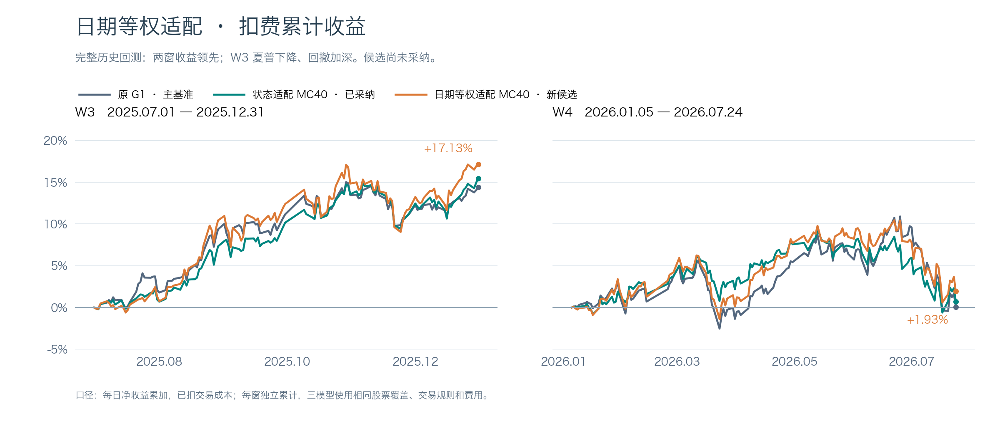
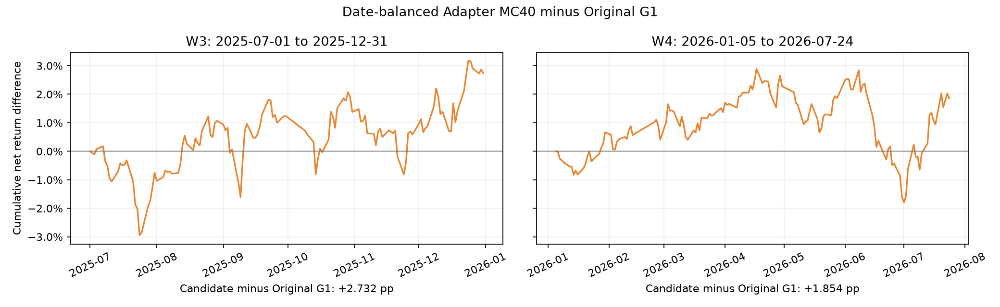

# 日期等权适配研究报告

> **2026-11-02纠偏提示：本文为旧成交单位口径的历史记录。** 原引擎将涨跌金额当收益率判断价格限制，旧收益数字及其优劣结论不能作为当前依据，旧运行入口也仍复现旧口径。请以[统一纠偏报告](成交限制单位纠偏与冻结方案复核报告_20261102.md)为准；原始记录保留追溯。

日期等权适配 MC40 已完成训练、双流两窗完整历史回测及覆盖核验；两窗均超过原G1，两窗均超过已采纳状态适配 MC40，主历史收益门槛通过。这仍仅是历史结果，不代表独立验证或未来盈利，不自动替换已采纳方案。

相对于已采纳状态适配 MC40，本轮唯一研究变量是训练窗口抽样分布：先均匀抽合法决策日期，再均匀抽该日股票窗口；原方案均匀抽全部股票窗口是另一种有效分布，并非 bug。底座、动态状态适配器、loss、验证缓存、双流推理与组合规则保持不变。原G1则是不含该适配器的原生成式模型基准。

主图为各窗 `cumsum(return-cost)`，共享纵轴；日期为实际交易日。原G1深灰蓝，已采纳MC40绿色，本轮候选橙色。

|窗口|模型|净累计|复利|Sharpe|最大回撤|总cost|日均turnover|相对原G1 pp|相对MC40 pp|
|---|---|---:|---:|---:|---:|---:|---:|---:|---:|
|W3|原G1|14.4018%|15.0381%|2.312355|-5.1597%|0.7422%|4.8364%|+0.0000|-1.0479|
|W3|状态适配 MC40（已采纳参照）|15.4497%|16.3250%|2.726379|-5.3090%|0.7601%|4.9722%|+1.0479|+0.0000|
|W3|日期等权适配 MC40（候选）|17.1340%|17.9832%|2.228781|-7.8357%|0.6547%|4.2972%|+2.7323|+1.6844|
|W4|原G1|0.0805%|-0.6691%|0.008980|-10.8645%|0.4411%|2.7591%|+0.0000|-0.6515|
|W4|状态适配 MC40（已采纳参照）|0.7321%|0.1964%|0.096694|-9.5259%|0.5756%|3.5615%|+0.6515|+0.0000|
|W4|日期等权适配 MC40（候选）|1.9344%|1.2535%|0.225380|-9.5609%|0.4561%|2.8486%|+1.8538|+1.2023|

W3：2025-07-01—2025-12-31，126日、37,223有效股票日期格；W4：2026-01-05—2026-07-24，134日、39,563格。完整有限mask与原G1一致，不裁股票池、不填补缺失。

Qlib 原生组合：CSI300 PIT，Top50/drop5/hold5，t信号次日open；买0.001、卖0.0015、最低5，涨跌停阈值0.095，初始资金1亿，benchmark 000300.SH。turnover为同一Qlib日报换手字段。Sharpe为sqrt(252)×日净收益均值/样本标准差（ddof=1、rf=0）；回撤按初始NAV=1的复利净值计算。

## 训练与控制复现

训练seed=100，从零初始化适配器；协议继承的training.seeds=[100,101,102]和inference.seed_per_day=100仅为历史字段，本轮以execution_seed=100及streams=[42,100]为准，未执行101/102训练确认；推理随机流分别为42与100，每流20条路径，均值信号0.5/0.5合并，每日重置种子。训练3000步、batch64、lr3e-4、AdamW betas=(0.9,0.95)、wd0.01、clip1，最后两层rank32动态适配器共107712参数；G1/tokenizer冻结且eval。验证每500步，固定2048窗口，最低CE选点、同分取早。

控制：best step=3000，CE=2.448015437；候选：best step=3000，CE=2.439534411。

控制与旧权重逐tensor比较：{"step_equal": true, "ce_equal": true, "new_step": 3000, "old_step": 3000, "new_ce": 2.448015436530113, "old_ce": 2.448015436530113, "tensors_equal": true, "max_abs": 0.0}。控制逐值复现后复用冻结MC40信号和日报作为机制控制；不是另行重跑控制双流推理。

训练标签末日≤2024-12-31；验证标签2025H1并拼接训练末90日。旧验证中56只股票历史前缀不足的覆盖选择原样保留，不在本轮同时修订。归一化和状态仅使用90日历史，loss位置89..98。

## 抽样审计与统计诊断

原语料5540只股票、9,736,925合法窗口、2577决策日；2023—2024占合法日期约18.4%，占窗口约25.3%。日期等权改变年份隐含权重，不能预设会改善收益。候选实际抽样分布复算文件为candidate_sample_date_counts.csv。

|窗口|比较对象|净累计差 pp|Sharpe差|最大回撤差 pp|收益差95%区间 pp|
|---|---|---:|---:|---:|---|
|W3|原G1|+2.7323|-0.083574|-2.6761|[-3.7757, +8.8785]|
|W3|状态适配 MC40（已采纳参照）|+1.6844|-0.497597|-2.5267|[-4.6087, +7.7758]|
|W4|原G1|+1.8538|+0.216401|+1.3036|[-6.2650, +8.5519]|
|W4|状态适配 MC40（已采纳参照）|+1.2023|+0.128687|-0.0350|[-6.0965, +8.1539]|

上述差值均为候选减比较对象；回撤差为负表示回撤更深。配对bootstrap固定20日块、5000次、seed100。四个95%收益差区间均跨零，不能据此声称有统计上稳健的收益改进。

W3净累计更高，但候选Sharpe 2.228781低于原G1的2.312355及MC40的2.726379；最大回撤为-7.8357%，比两者更深。W4 Sharpe提高，最大回撤优于原G1，但相对MC40略深约0.0350个百分点。收益门槛通过并不代表风险指标全面改善。

相对MC40，总成本在W3/W4分别减少约0.1054/0.1196个百分点；净累计优势分别为1.6844/1.2023个百分点，成本下降只解释其中一部分。不能把全部收益差归因于换手下降。

累计GPU阶段墙时 16877.621秒（4.688小时），其中完整双流推理16574.836秒，低于21600秒硬预算；两次训练和推理均未中断恢复。实际抽样192000次，2023—2024合计35013次，占18.236%，详见逐批重放审计。

历史窗口已反复查看且存在多次研究试验，bootstrap仅作配对时序诊断，不是独立确认。2026-07-25及以后forward继续封存。

## 执行修订与审查

[上级独立审查处置](日期等权适配审查处置_20261101.md)逐项记录了逐批抽样审计、控制恢复门禁、best_step元数据、类型文档及历史种子字段处理。两臂均从零连续完成，未发生训练恢复；这些工程修正未改变冻结权重或评估方案。协议未修改。

## 复现与身份

- 分支：`codex/date-balanced-20261101`；代码提交：`55aaa6ccad20ae10b5074a453c613e0c0b4b8118`；base：`9e969d90062f8aae39903dc1fd1ae614922f6179`；协议预先提交：`32f5748`。
- 协议 canonical SHA256：`d6ccd26861b9c048bca62e9c169db17f801e1c31c92cf02933b38464c78434ca`；不可变protocol.json与sidecar、原baseline/corpus/参考文件SHA均位于实验目录。
- 实际训练代码提交：`ff38096`；实际完整推理启动提交：`ed127c7`；审查处置提交：`29b33b2`。详见execution_provenance.json。训练期间仅补充审计和恢复元数据处理，未更换已加载训练代码或重训。
- MC40 manifest全部源信号SHA核验通过，旧双流重新等权合并与冻结MC40信号逐值一致，见reference_source_audit.json；日报核心指标独立复算见reference_metrics_audit.json。
- 候选权重SHA256：`2c45c8a38559653c9be72facbd8ca911e621f9448f5919573dbfc9a621aaa13d`；base_state_hash：`b16a609e4f8a9828a93720ebaa00f95437e64c557b4366b8675d110a65b05636`。
- 原适配器SHA256：`d208a8b9f5359aa81bd6cfff473bf9aae193f0b37542e92b7ae39d00c649c402`；验证缓存SHA256：`99eb3d1b18d06015759c6eb8ed3fba7ebedbb8ec722e4e730e66eab975360eb2`。
- 训练与完整推理/回测：`/home/user/miniconda3/envs/quant/bin/python -m state_adapter.date_balanced_run --stage all`；可分别选train/infer/backtest/report；freeze只验证已冻结协议，不重写。
- 仅复算已完成日报的报告与图：`/home/user/miniconda3/envs/quant/bin/python -m state_adapter.date_balanced_report`。此入口不启动训练或推理，避免原实验8小时执行窗口限制阻止日后复算。
- 产物：`artifacts/experiments/date_balanced_20261101/` 下report_*.parquet、daily_*.parquet、metrics.json/csv、coverage.json、training_*.json/jsonl、control_comparison.json、gpu_budget.json。
- GPU硬预算21600秒，累计跨控制/候选训练与推理；墙钟上限28800秒。消耗见gpu_budget.json和execution_clock.json。

## 本地交付复核（2026-11-02）

从远端结果提交 `3aa1786efe989364a8e5351c6725ffd357b0ccb6` 回收后，独立核验19个文件哈希、六份日报的全部核心指标与累计曲线、四组信号日期覆盖及双流等权合成，均通过。主图中文版本直接从相同日报重新绘制；数值和原图一致，原图仍保留为 `assets/date_balanced_20261101/cumulative.png`。本地核验记录为 `artifacts/experiments/date_balanced_20261101/local_independent_audit_20261102.json`。
