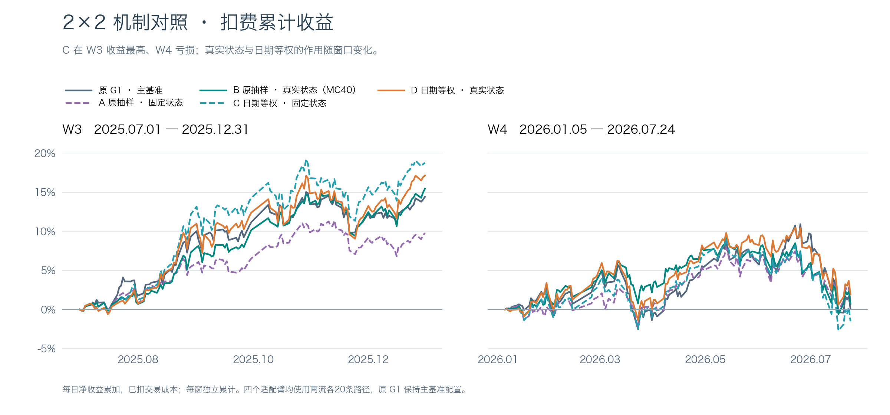
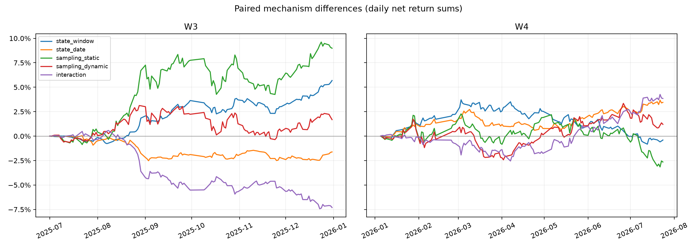
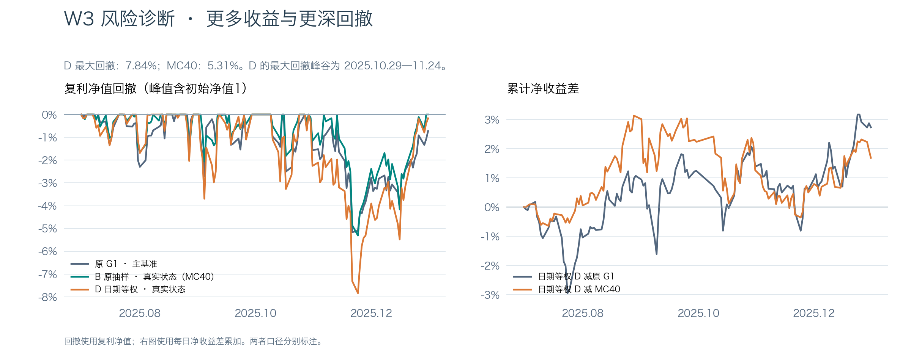
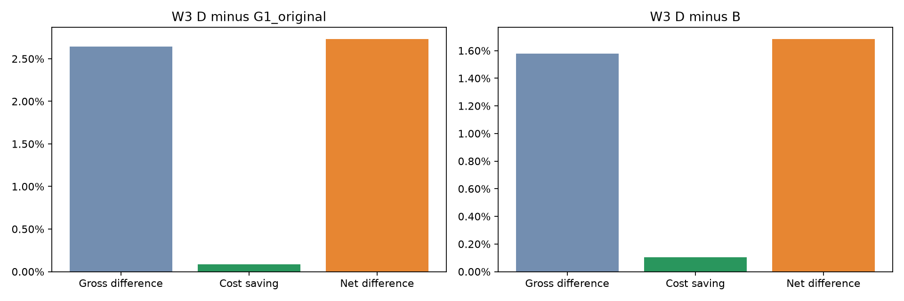

# 状态适配二乘二机制与W3风险归因报告

> **2026-11-02纠偏提示：本文为旧成交单位口径的历史记录。** 原引擎将涨跌金额当收益率判断价格限制，旧收益数字及其优劣结论不能作为当前依据，旧运行入口也仍复现旧口径。请以[统一纠偏报告](成交限制单位纠偏与冻结方案复核报告_20261102.md)为准；原始记录保留追溯。

完整2×2机制对照与W3持仓归因已完成并独立复算。真实状态的收益增量随抽样方式和窗口变化，未显示跨窗一致的叠加优势。新增的日期等权静态臂C在W3净累计18.75%，但W4为−1.51%，未达到两窗超过原G1或MC40的条件。日期等权动态臂D仍是两窗累计收益更高的候选，尚未采纳。

W3的收益优势伴随更高风险：D相对MC40的日均净收益增加10.90%，日波动增加35.66%，导致夏普下降。实际成交与持仓对账显示，300308.SZ的净贡献差约+3.90个百分点，高于组合净优势+1.68个百分点，其他股票存在抵消；该股也是方差增加的重要来源。成本下降仅解释净优势的6.26%。以下机制区间均是未作多重比较校正的名义95%区间；单训练种子和重复查看历史窗口限制了其确认力度。

本轮只改变训练抽样与状态输入的两个机制。A为原窗口均匀×固定零状态static，B为原窗口均匀×真实状态dynamic（已采纳MC40），C为日期等权×static（唯一新增训练臂），D为日期等权×dynamic（冻结候选）。G1/tokenizer冻结；四臂均train seed100、last2/rank32和107712名义参数，static保留gate且仅将state置零，部分参数没有数据梯度，因此不宣称有效自由度严格相同。四格均为infer seed42/100各20路径等权；原G1为canonical seed42单流20。



主图原G1深灰蓝、B绿色、D橙色；A紫色虚线、C青色虚线。两窗独立面板共享纵轴，包含全部四格与原G1。

|窗口|模型|净累计|复利|年化Sharpe|最大回撤|总成本|日均换手|相对原G1 pp|相对B pp|
|---|---|---:|---:|---:|---:|---:|---:|---:|---:|
|W3|原G1|14.4018%|15.0381%|2.312355|-5.1597%|0.7422%|4.8364%|+0.0000|-1.0479|
|W3|A 原窗口×静态|9.7641%|9.9934%|2.005461|-4.4919%|0.7021%|4.5997%|-4.6376|-5.6855|
|W3|B 已采纳状态适配MC40|15.4497%|16.3250%|2.726379|-5.3090%|0.7601%|4.9722%|+1.0479|+0.0000|
|W3|C 日期等权×静态|18.7514%|19.8823%|2.400391|-7.6865%|0.6627%|4.3400%|+4.3496|+3.3017|
|W3|D 日期等权×动态|17.1340%|17.9832%|2.228781|-7.8357%|0.6547%|4.2972%|+2.7323|+1.6844|
|W4|原G1|0.0805%|-0.6691%|0.008980|-10.8645%|0.4411%|2.7591%|+0.0000|-0.6515|
|W4|A 原窗口×静态|1.1326%|0.5866%|0.147958|-8.1568%|0.4893%|3.0553%|+1.0521|+0.4005|
|W4|B 已采纳状态适配MC40|0.7321%|0.1964%|0.096694|-9.5259%|0.5756%|3.5615%|+0.6515|+0.0000|
|W4|C 日期等权×静态|-1.5149%|-2.1542%|-0.179936|-11.4083%|0.4972%|3.0953%|-1.5954|-2.2470|
|W4|D 日期等权×动态|1.9344%|1.2535%|0.225380|-9.5609%|0.4561%|2.8486%|+1.8538|+1.2023|

净累计为sum(return−cost)，复利另列；Sharpe为sqrt(252)×均值/样本标准差，无风险利率0；MDD包含初始NAV1。W3 126日/37223有限格，W4 134日/39563有限格，W4首交易日2026-01-05。Qlib原生Top50/drop5/hold5、t信号次日open，买0.001卖0.0015最低5，涨跌停阈值0.095，初始资金1亿，CSI300时点股票池；无额外信号shift、无样本裁剪。换手为Qlib实际成交金额/前日账户价值。

## 配对机制与区间

|窗口|机制|累计差 pp|95%下界 pp|95%上界 pp|
|---|---|---:|---:|---:|
|W3|state 原抽样 B−A|+5.6855|+0.8273|+10.6630|
|W3|state 日期等权 D−C|-1.6173|-5.5482|+1.6298|
|W3|sampling 静态 C−A|+8.9872|-2.0812|+20.4095|
|W3|sampling 动态 D−B|+1.6844|-4.6087|+7.7758|
|W3|交互 (D−C)−(B−A)|-7.3029|-14.7256|-1.4261|
|W4|state 原抽样 B−A|-0.4005|-5.9201|+5.5735|
|W4|state 日期等权 D−C|+3.4492|-0.7476|+7.1530|
|W4|sampling 静态 C−A|-2.6475|-9.7709|+4.4566|
|W4|sampling 动态 D−B|+1.2023|-6.0965|+8.1539|
|W4|交互 (D−C)−(B−A)|+3.8498|-2.2512|+9.8911|

同一时间索引的日净收益差直接执行20日circular block bootstrap，5000次、seed100；先算每日四序列交互再共同抽日期块，不是四个独立区间相减。以上CI仅对应净收益累计差，不能用于Sharpe或MDD差。历史窗口反复查看，不能宣称多训练seed、独立验证或现实严格因果。



## W3收益提高但风险恶化

|模型|日均净收益|日样本波动|年化波动|峰值日|谷值日|恢复日|峰谷交易日数|水下交易日数|
|---|---:|---:|---:|---|---|---|---:|---:|
|原G1|0.114300%|0.784677%|12.4564%|2025-10-29|2025-11-21|窗内未恢复|17|45|
|B 已采纳状态适配MC40|0.122617%|0.713942%|11.3335%|2025-11-06|2025-11-24|2025-12-30|12|38|
|D 日期等权×动态|0.135984%|0.968550%|15.3753%|2025-10-29|2025-11-24|窗内未恢复|18|45|

D相对B 已采纳状态适配MC40净收益差+1.6844pp = 毛收益差+1.5789pp + 成本节省+0.1054pp。成本节省解释净优势的6.26%。均值比为1.1090，波动比为1.3566：波动增幅超过均值增幅，因此Sharpe下降。优势日59天、劣势日66天，正差额合计+20.185pp、负差额合计-18.501pp。去掉绝对差额最大的5天后差额为+1.1693pp，属于后验敏感性，不改变主指标或选策略。
最高5日（pp）：{'2025-09-05': 1.1671554522958492, '2025-10-21': 0.9959409439676767, '2025-09-11': 0.9818918495246542, '2025-08-22': 0.9200021111541591, '2025-10-24': 0.8313487188450011}；最低5日（pp）：{'2025-09-02': -1.5046442255578765, '2025-10-14': -1.1252631192905214, '2025-10-31': -0.9300138005043093, '2025-09-26': -0.7823460779233473, '2025-11-21': -0.7085209398925673}。

D相对原G1净收益差+2.7323pp = 毛收益差+2.6447pp + 成本节省+0.0875pp。成本节省解释净优势的3.20%。均值比为1.1897，波动比为1.2343：波动增幅超过均值增幅，因此Sharpe下降。优势日66天、劣势日59天，正差额合计+23.277pp、负差额合计-20.544pp。去掉绝对差额最大的5天后差额为+1.6546pp，属于后验敏感性，不改变主指标或选策略。
最高5日（pp）：{'2025-09-10': 1.3029094350453387, '2025-09-11': 1.0433365529873004, '2025-11-26': 1.0186416646004741, '2025-12-17': 0.9854960009349746, '2025-10-21': 0.9823203363977406}；最低5日（pp）：{'2025-09-08': -1.1578131723193916, '2025-10-14': -1.1293545857156762, '2025-07-24': -0.9296569604135286, '2025-11-21': -0.90238509732227, '2025-09-04': -0.8770850753846916}。





各模型最大回撤区间内全部模型的净累计/复利收益：

```json
{
  "G1_original": {
    "G1_original": {
      "net_sum": -0.05232330122006559,
      "compound": -0.051596585066016165
    },
    "B": {
      "net_sum": -0.048544333918118486,
      "compound": -0.047989935997325595
    },
    "D": {
      "net_sum": -0.0747881959852755,
      "compound": -0.07310387706628618
    }
  },
  "B": {
    "G1_original": {
      "net_sum": -0.04224885263501047,
      "compound": -0.041844881229235464
    },
    "B": {
      "net_sum": -0.05404399312131764,
      "compound": -0.053090362027249705
    },
    "D": {
      "net_sum": -0.06278492635996998,
      "compound": -0.06164707636707656
    }
  },
  "D": {
    "G1_original": {
      "net_sum": -0.05166146623875976,
      "compound": -0.05096889850962283
    },
    "B": {
      "net_sum": -0.05325590123661324,
      "compound": -0.052475395501758726
    },
    "D": {
      "net_sum": -0.08045600833939366,
      "compound": -0.07835735036283409
    }
  }
}
```

## 真实账户与持仓证据

通过只读Account.update_bar_end回调在原方法执行后观察实际trade_info与估值后的position，原方法返回值原样透传；没有用预测Top50冒充持仓。个股毛损益=前日股数×估值变化+各笔带符号成交股数×(当日估值−成交价格)，统一除以前日账户价值；费用单列。完全卖出的股票仍读取当日同Exchange收盘估值。

|模型|冻结日报重放最大误差|个股毛收益对账最大残差|费用对账最大残差|
|---|---:|---:|---:|
|原G1|7.997e-16|6.436e-16|9.216e-19|
|B 已采纳状态适配MC40|8.171e-16|6.037e-16|1.057e-18|
|D 日期等权×动态|8.899e-16|5.664e-16|7.928e-19|

### D减B 已采纳状态适配MC40

full_W3个股净贡献差合计+1.6844pp；按个股汇总后绝对贡献Top1/5/10占绝对贡献总和：{'1': 0.12613087936870318, '5': 0.25916613527397286, '10': 0.38206236909466434}。正负抵消使带符号贡献占净差额比例可能超过100%，不以该比例声称收益稳定。
主要正贡献股票（pp）：{'300308.SZ': 3.9033973265483635, '002463.SZ': 1.0674796075992647, '000807.SZ': 1.0274966673641994, '002475.SZ': 0.935682901334631, '000408.SZ': 0.709987957645654, '600183.SH': 0.6697303079700916, '000792.SZ': 0.628164505305768, '601138.SH': 0.535515277609664, '600111.SH': 0.3433586171681963, '603019.SH': 0.3383011310724595}。主要负贡献股票（pp）：{'601689.SH': -1.0864092595710528, '600160.SH': -0.8159406069260305, '603993.SH': -0.8105008113983174, '002074.SZ': -0.7971344256352717, '000338.SZ': -0.6000246365851963, '002050.SZ': -0.5429113526589013, '600176.SH': -0.5119650212950763, '601699.SH': -0.44796440612046207, '601899.SH': -0.4274507881133498, '688599.SH': -0.3859814000369827}。

D_drawdown个股净贡献差合计-2.7200pp；按个股汇总后绝对贡献Top1/5/10占绝对贡献总和：{'1': 0.07692401926568632, '5': 0.2882523661768947, '10': 0.4410560178486903}。正负抵消使带符号贡献占净差额比例可能超过100%，不以该比例声称收益稳定。
主要正贡献股票（pp）：{'601689.SH': 0.4008442656439624, '600160.SH': 0.2812543062366908, '600415.SH': 0.20500781067767157, '300316.SZ': 0.20313939337409853, '600958.SH': 0.20056395329301843, '603993.SH': 0.18849705654898694, '300661.SZ': 0.1758568644804571, '603019.SH': 0.16529207945861638, '002050.SZ': 0.14499522796916972, '300408.SZ': 0.11618096699248984}。主要负贡献股票（pp）：{'002463.SZ': -0.7093396324161166, '000338.SZ': -0.6668831555771185, '300308.SZ': -0.5409106688158555, '601138.SH': -0.34008447214943616, '000063.SZ': -0.29797754938729326, '688599.SH': -0.2946339612698744, '600111.SH': -0.28877981960254384, '002459.SZ': -0.24640302143119278, '688472.SH': -0.24029879871709925, '000630.SZ': -0.21116377542208134}。

平均持仓重叠：{'weight_overlap': 0.437785685642577, 'jaccard': 0.39930930784248636}；日初权重加权暴露差均值：{'vol20': 0.05923662710169379, 'vol20_covered_weight': -0.008349582063545514, 'vol60': 0.04514679957245019, 'vol60_covered_weight': -0.008349582063545514, 'momentum60': 0.09927274037797103, 'momentum60_covered_weight': -0.008349582063545514, 'beta60': 0.2119274790130613, 'beta60_covered_weight': -0.008349582063545514}。


### D减原G1

full_W3个股净贡献差合计+2.7323pp；按个股汇总后绝对贡献Top1/5/10占绝对贡献总和：{'1': 0.11228262700755093, '5': 0.2803708436615032, '10': 0.3894052811919175}。正负抵消使带符号贡献占净差额比例可能超过100%，不以该比例声称收益稳定。
主要正贡献股票（pp）：{'300308.SZ': 3.499972027977477, '601138.SH': 2.464810953698831, '000807.SZ': 0.894950576673618, '600183.SH': 0.8269708075878226, '002475.SZ': 0.7571910057225897, '601688.SH': 0.44403620522547516, '000408.SZ': 0.3810162601115762, '600115.SH': 0.37369673978555856, '688303.SH': 0.34561606179605253, '601336.SH': 0.33308733393424667}。主要负贡献股票（pp）：{'601698.SH': -1.02420521683888, '002709.SZ': -0.8555264157148268, '002600.SZ': -0.6560535987238735, '601600.SH': -0.6011260793640159, '601868.SH': -0.5573809255348551, '601872.SH': -0.4975715567688013, '688472.SH': -0.4728853874616832, '600176.SH': -0.44980666915322814, '600160.SH': -0.40933610407114623, '600362.SH': -0.39376916262946854}。

D_drawdown个股净贡献差合计-2.8795pp；按个股汇总后绝对贡献Top1/5/10占绝对贡献总和：{'1': 0.14891952038046105, '5': 0.3130657071691195, '10': 0.43957341540921574}。正负抵消使带符号贡献占净差额比例可能超过100%，不以该比例声称收益稳定。
主要正贡献股票（pp）：{'002600.SZ': 0.47402158728183974, '688396.SH': 0.308841658981074, '603501.SH': 0.23473476986423064, '600104.SH': 0.2144468872898524, '601012.SH': 0.19628393634973013, '002736.SZ': 0.17543099372589754, '600438.SH': 0.17108537048622083, '002601.SZ': 0.15442116715714216, '601901.SH': 0.13587597818469116, '601698.SH': 0.12819077819966837}。主要负贡献股票（pp）：{'601138.SH': -1.5468573242660673, '002938.SZ': -0.4681763576849026, '300308.SZ': -0.4349200096516952, '300759.SZ': -0.32790184826360697, '000063.SZ': -0.29797754938729326, '002459.SZ': -0.24640302143119278, '601600.SH': -0.22610427697313673, '603986.SH': -0.19268302762450004, '601988.SH': -0.18296687747529475, '600515.SH': -0.17434228746328329}。

平均持仓重叠：{'weight_overlap': 0.34792416446967817, 'jaccard': 0.29200128585060775}；日初权重加权暴露差均值：{'vol20': 0.050779060134165284, 'vol20_covered_weight': 0.007985327258261498, 'vol60': 0.06001612990224589, 'vol60_covered_weight': 0.007985327258261498, 'momentum60': 0.09636206895181051, 'momentum60_covered_weight': 0.007985327258261498, 'beta60': 0.16918118740027116, 'beta60_covered_weight': 0.007985327258261498}。


从上述真实持仓贡献看，D相对B的额外收益主要贡献股300308.SZ也位于额外方差贡献前列；D回撤区间的负差集中于002463.SZ、000338.SZ、300308.SZ等，D相对原G1的回撤差中601138.SH较突出。历史波动、动量和beta暴露差与风险增加方向一致，但不构成训练抽样改变真实市场风险的因果证明。行业及市值资料缺项，无法判断这些个股差额是否主要来自相应暴露。


### 方差来源的精确恒等式

以已扣交易成本的逐股日贡献计算Cov(个股贡献,组合日净收益)，另将账户对账残差作为独立项；加总应等于组合日净收益样本方差。以下是方差的会计分解，不是干预因果。

|模型|日净收益样本方差|逐股方差对账残差|Top1/5/10方差贡献占比|
|---|---:|---:|---|
|G1_original|0.0000615719|1.355e-20|{'1': 0.05931280632878219, '5': 0.24081071573506552, '10': 0.41514599708221084}|
|B|0.0000509714|0.000e+00|{'1': 0.08626860367053407, '5': 0.30237217391894106, '10': 0.46451371237759076}|
|D|0.0000938090|0.000e+00|{'1': 0.11238015267032604, '5': 0.390808474063273, '10': 0.5426364116288772}|

相对B：Var(D)=Var(B)+Var(D−B)+2Cov(B,D−B) = 0.0000509714+0.0000171031+0.0000257345=0.0000938090，恒等式残差3.727e-20。
方差增量主要股票（样本方差单位）：{'300308.SZ': 1.0542265014276605e-05, '002463.SZ': 6.1847981509465855e-06, '601138.SH': 5.525011283749109e-06, '600183.SH': 3.7229971754852184e-06, '600111.SH': 2.7844449168376176e-06}。

相对G1_original：Var(D)=Var(G1_original)+Var(D−G1_original)+2Cov(G1_original,D−G1_original) = 0.0000615719+0.0000208422+0.0000113949=0.0000938090，恒等式残差4.913e-20。
方差增量主要股票（样本方差单位）：{'300308.SZ': 1.0027208515706663e-05, '601138.SH': 9.922241063441985e-06, '002938.SZ': 3.9795614295267915e-06, '600183.SH': 3.5225515190211597e-06, '002463.SZ': 3.4220126269133767e-06}。
各模型日初集中度均值（HHI按股票权重平方和，现金另列）：

```json
{
  "B": {
    "hhi": 0.01573270510122202,
    "max_weight": 0.029191855098021385,
    "invested_weight": 0.831326383373863,
    "cash_weight": 0.16867361662613706
  },
  "D": {
    "hhi": 0.01647217064280794,
    "max_weight": 0.03740147696850661,
    "invested_weight": 0.8229768013103175,
    "cash_weight": 0.17702319868968258
  },
  "G1_original": {
    "hhi": 0.015355346440063408,
    "max_weight": 0.024861930282160775,
    "invested_weight": 0.8149914740520559,
    "cash_weight": 0.18500852594794406
  }
}
```

暴露仅使用当时前一交易日及更早的20/60日波动、60日动量与60日市场beta，采用日初真实持仓权重；逐日暴露差和可用权重保存在risk目录。行业和流通市值缺少已核验时点接口，明确缺项，未用最新行业替代。价量暴露和个股贡献提供描述性证据，不能证明因果，也不是完整风险模型。

## 训练、复用及复现

A旧权重冻结，另从零重训控制3000步与旧A逐tensor完全一致(max_abs=0)；旧A100每窗首中末三日核验后复用，新增A42。B旧MC40双流/信号/日报冻结复用，D上轮日期等权动态冻结复用，C为本轮从零训练static并新增42/100两流；没有将dynamic临时置零冒充static控制。旧A与共享验证cache逐tensor一致，容器SHA是否相同另列。

所有训练均使用2024-12-31及以前标签、2025H1固定2048窗口验证，每500步最低CE选点，同分较早，未用W3/W4选checkpoint。C与D日期等权采样逐批重放审计见sampling_audit.json。

分支codex/state-factorial-20261102；报告生成提交b5cf90b7cffc8fa933a89cffdae64def26862411；基点3aa1786efe989364a8e5351c6725ffd357b0ccb6；协议canonical SHA `fcf92d2447fab4d59fc00f3e1495bbc1c01b4dffd4a5064e9fbb572a10d719fc`。

|臂|权重SHA256|原训练协议|配置SHA|
|---|---|---|---|
|A|873db507a7ae6109274fca0072a46be06dab583b968e5d83e705eea9ccafad17|1c113930fcf3ba2dd75c8e6c8e24bfeaad19f221a76387aba8ec663ffdddd990|f0be49f5e4e8cf32bd8c5a7359a7486d2a03dfdb1eb6133b06da6263e9fbe75e|
|B|d208a8b9f5359aa81bd6cfff473bf9aae193f0b37542e92b7ae39d00c649c402|1c113930fcf3ba2dd75c8e6c8e24bfeaad19f221a76387aba8ec663ffdddd990|f0be49f5e4e8cf32bd8c5a7359a7486d2a03dfdb1eb6133b06da6263e9fbe75e|
|D|2c45c8a38559653c9be72facbd8ca911e621f9448f5919573dbfc9a621aaa13d|d6ccd26861b9c048bca62e9c169db17f801e1c31c92cf02933b38464c78434ca|f17b42a0df0d58cc0ceff977a5e3762ac7dced5b7adbe572b01bae75b8fb30e6|
|C|b09ee8f15bfdf23968f08ef7d62d7383803e5b30ad60fedece06ca196cb7f55f|fcf92d2447fab4d59fc00f3e1495bbc1c01b4dffd4a5064e9fbb572a10d719fc|dde645f113c465fc40521603fc0ccfad0fc19fcbb303fc49c5f3dc395f00050d|

本轮累计新GPU阶段耗时26639.8秒，上限36000秒；旧A/B/D训练推理为历史计算，未计成本轮重做。冻结输入、数据/底座/cache/SHA见protocol.json，旧实验预算分别位于各自源目录gpu_budget.json。

原始小产物位于artifacts/experiments/state_factorial_20261102：report/daily/metrics、mechanism_daily、final_signal_audit、reuse_checks、control_comparison、sampling_audit及risk/{模型}/positions、trades、stock_daily_contributions、balances、reconciliation_audit；大权重在arms目录按SHA绑定。

复算命令（quant Python）：

```bash
/home/user/miniconda3/envs/quant/bin/python -m state_adapter.factorial_run --stage backtest
CUDA_VISIBLE_DEVICES= /home/user/miniconda3/envs/quant/bin/python -m state_adapter.risk_attribution
CUDA_VISIBLE_DEVICES= /home/user/miniconda3/envs/quant/bin/python -m state_adapter.risk_attribution --analysis-only
/home/user/miniconda3/envs/quant/bin/python -m state_adapter.factorial_report
```

主协调器负责独立复算、本地回收与master索引发布；本分支不push、不切master。历史收益优胜与机制区间证据分别报告，不自动采纳候选。


## 最终独立复核与交付

2026-11-02由主协调器独立复算10份日报及累计曲线、10项配对机制收益差与共同日期块置信区间、3组真实持仓/成交/现金/NAV账及逐股收益和方差对账，均通过。837条实际行情请求记录的最大有效末日为2026-07-24，封存边界未越过；冻结协议和引用文件哈希再次核验通过。中文图由相同日报重绘，原始图保留。核验记录为`artifacts/experiments/state_factorial_20261102/local_final_audit_20261102.json`。原G1保持主基准，MC40保持已采纳参照，本轮未自动采纳C/D。

远端最终结果提交：`7e2cf0324ee2525b592270110c9ab042512cad06`。主分支归档包含完整报告、图表、逐日报表及风险归因材料。
